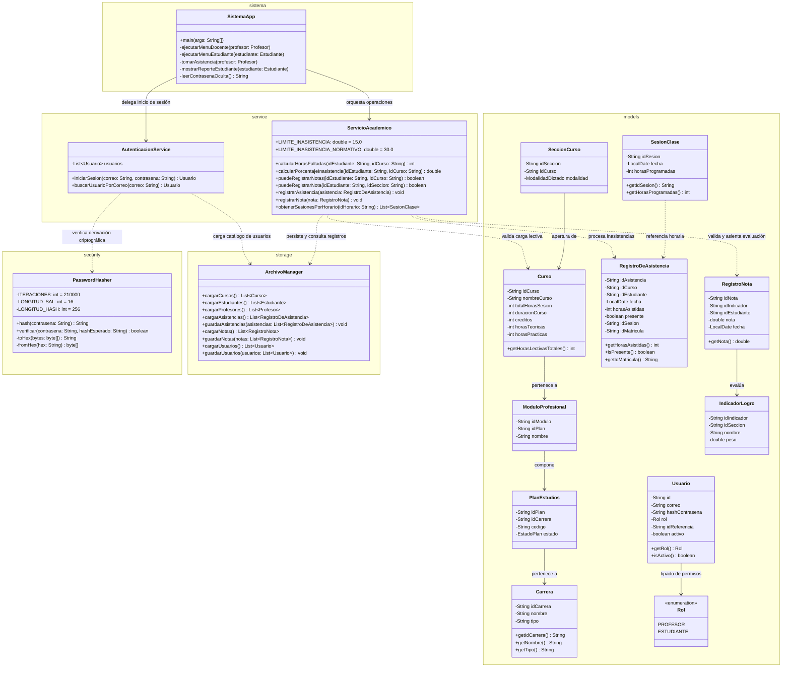

# Sistema de Control y Monitoreo de Asistencia — IESTP Chincha

**Informe Técnico y Documentación de Ingeniería de Software**  
_Curso:_ Paradigmas de Programación I  
_Facultad:_ Facultad de Ingeniería e Inteligencia Artificial  
_Carrera:_ Escuela Profesional de Ingeniería en Ciberseguridad  
_Plataforma:_ Java Platform, Standard Edition 21 (Java SE 21 LTS)

---

## Objetivos

### i. Objetivo General

Desarrollar un software en lenguaje Java SE bajo los fundamentos de Paradigmas de Programación y una arquitectura limpia por capas, aplicando principios de Seguridad por Diseño (Security by Design) para la gestión y consulta de la asistencia estudiantil en el Instituto de Educación Superior Tecnológico Público (IESTP) Chincha; garantizando la integridad, confidencialidad y trazabilidad de los datos académicos mediante autenticación robusta por roles, persistencia desacoplada y la aplicación sistemática de las normativas de inasistencia del Ministerio de Educación (MINEDU).

### ii. Objetivos Específicos

1. Modelar formalmente el dominio académico e institucional: Aplicar abstracción, encapsulamiento estricto, modularidad y tipado fuerte mediante enumeraciones para estructurar las entidades del ecosistema formativo, garantizando la cohesión interna y la consistencia relacional de la información.
2. Implementar un subsistema de autenticación y control de acceso basado en roles (RBAC): Desarrollar un mecanismo de control de acceso que valide identidades mediante credenciales institucionales, segregando estrictamente los privilegios operativos entre los roles de profesor y estudiante bajo el principio de menor privilegio.
3. Incorporar controles criptográficos avanzados para el almacenamiento y verificación de credenciales: Mitigar vulnerabilidades de exposición de contraseñas mediante la implementación del algoritmo PBKDF2 con HMAC-SHA256, empleando sales pseudoaleatorias criptográficamente seguras de 128 bits y un factor de costo computacional de 210,000 iteraciones para neutralizar ataques de fuerza bruta offline y tablas arcoíris.
4. Proteger el canal de entrada de credenciales en tiempo de ejecución: Implementar mecanismos de captura de secretos mediante canales seguros de consola para evitar la persistencia de datos sensibles en memoria no administrada, buffers de salida estándar o historiales de terminal.
5. Automatizar el registro transaccional de asistencia con validación de fronteras: Desarrollar el flujo de captura de asistencia por sesión horaria con fecha determinista, forzando la validación defensiva del rango de horas asistidas en el intervalo cerrado $[0, \text{horasProgramadas}]$ para prevenir anomalías en la bitácora.
6. Programar el algoritmo de alerta temprana institucional: Diseñar la lógica para el cálculo continuo del porcentaje de faltas respecto a la carga horaria programada, emitiendo alertas preventivas automáticas cuando el estudiante supere el umbral del 15% de inasistencia.
7. Aplicar la regla de inhabilitación normativa institucional y del MINEDU: Computar el índice acumulado de inasistencias sobre el total de horas lectivas de la Unidad Didáctica como una precondición booleana que inhabilite de forma estricta el registro de calificaciones cuando el índice supere el 30%, resguardando la validez del proceso evaluativo.
8. Diseñar el módulo de evaluación continua sobre Indicadores de Logro: Habilitar el registro y ponderación de calificaciones en escala vigesimal vinculadas a los indicadores de logro, validando previamente la existencia de matrícula activa y la habilitación por asistencia.
9. Desarrollar una capa de persistencia ligera y desacoplada: Construir un motor de serialización y deserialización hacia archivos planos estructurados, implementando tolerancia a variaciones de esquema para garantizar la resiliencia del sistema ante cambios de estructura sin recurrir a bases de datos externas.
10. Adoptar una arquitectura de dependencias mínimas para reducir la superficie de ataque: Construir la totalidad del aplicativo apoyándose estrictamente en la biblioteca estándar de Java SE 21, eliminando dependencias de terceros para neutralizar riesgos asociados a vulnerabilidades en la cadena de suministro de software.

---

## g) Desarrollo

### i. Identificación de requerimientos

#### Contexto del Problema y Justificación en Ciberseguridad

En el ámbito de la gestión académica institucional, el IESTP Chincha requiere administrar el flujo de asistencias y evaluaciones de manera precisa. Los procesos tradicionales basados en bitácoras físicas o libros de cálculo distribuidos presentan serias vulnerabilidades y fallas de ingeniería:

- **Ausencia de controles de integridad y no repudio:** La manipulación manual de registros permite la alteración no autorizada de horas asistidas o fechas de toma de asistencia.
- **Inseguridad en el almacenamiento de credenciales:** Uso común de contraseñas en texto claro o mecanismos de hash obsoletos (MD5, SHA-1) susceptibles a colisiones y ataques por diccionario.
- **Inconsistencia en el cómputo de inasistencias:** Cálculo simplista por "días" en lugar de "horas lectivas efectivas", lo que distorsiona la aplicación de la normativa ministerial sobre inasistencias parciales.
- **Falta de segregación de funciones:** Ausencia de un control de acceso basado en roles que restrinja qué operaciones puede realizar un estudiante frente a un docente.

#### Análisis de Actores y Vectores Operativos

1. **Docente (`PROFESOR`):**
   - Requiere autenticarse contra el sistema con credenciales institucionales seguras.
   - Accede a la visualización de su carga lectiva, secciones asignadas y listas de estudiantes debidamente matriculados.
   - Ejecuta la toma de asistencia por sesión horaria específica, ingresando únicamente las horas presenciales efectivas.
   - Asienta calificaciones vigesimales ($0.0 \leq \text{nota} \leq 20.0$) sobre Indicadores de Logro, sujeto a la verificación automatizada del límite normativo de inasistencia.
2. **Estudiante (`ESTUDIANTE`):**
   - Requiere autenticarse para consultar su información académica personal y condición de matrícula.
   - Accede a reportes analíticos de asistencia por asignatura (sesiones dictadas, horas asistidas, inasistencias acumuladas y porcentaje de inasistencia).
   - Recibe alertas visuales preventivas ante el riesgo de desaprobación por inasistencia.
   - Consulta las notas obtenidas en los indicadores evaluados.

---

### ii. Análisis de Hardware

El aplicativo ha sido concebido para operar con un consumo de recursos mínimo, garantizando al mismo tiempo la capacidad de ejecutar derivaciones criptográficas intensivas en CPU para la protección de credenciales:

| Recurso Físico                       | Especificación Mínima                      | Especificación Recomendada                       | Justificación de Ingeniería y Seguridad                                                                                                                                                                |
| :----------------------------------- | :----------------------------------------- | :----------------------------------------------- | :----------------------------------------------------------------------------------------------------------------------------------------------------------------------------------------------------- |
| **Arquitectura de Procesador (CPU)** | x86-64 o ARM64 (1 núcleo físico a 1.5 GHz) | x86-64 o ARM64 multi-núcleo a 2.0 GHz o superior | Capacidad para procesar iteraciones intensivas de PBKDF2-HMAC-SHA256 (210,000 ciclos por hash/verificación) en menos de 100 ms sin degradar la experiencia interactiva de usuario.                     |
| **Memoria Principal (RAM)**          | 512 MB dedicados a la JVM                  | 2 GB o superior                                  | Alojamiento en memoria de las estructuras de datos relacionales (colecciones en heap) de los 20 catálogos CSV sin incurrir en _swapping_ ni sobrecarga del Recolector de Basura (_Garbage Collector_). |
| **Almacenamiento Secundario**        | 100 MB libres en disco                     | 500 MB libres (Unidad de Estado Sólido - SSD)    | Espacio suficiente para código fuente compilado, suite de pruebas automatizadas y persistencia síncrona de archivos CSV con baja latencia de E/S.                                                      |
| **Dispositivos de Entrada/Salida**   | Teclado estándar y terminal interactiva    | Terminal interactiva con soporte ANSI            | Requerido para interacción TTY, lectura oculta de contraseñas vía consola (`System.console()`) y renderizado de interfaces textuales.                                                                  |

---

### iii. Análisis de Software

#### Stack Tecnológico y Entorno de Ejecución

El proyecto sigue una política estricta de **cero dependencias externas**, reduciendo a cero el vector de vulnerabilidades originadas por dependencias transitivas o librerías desactualizadas:

| Componente                         | Especificación Técnica                                                                                                                                                                                                                                                              | Justificación Técnica y de Seguridad                                                                                                                                                                                            |
| :--------------------------------- | :---------------------------------------------------------------------------------------------------------------------------------------------------------------------------------------------------------------------------------------------------------------------------------- | :------------------------------------------------------------------------------------------------------------------------------------------------------------------------------------------------------------------------------ |
| **Lenguaje y Versión**             | Java Platform, Standard Edition 21 (Java SE 21 LTS)                                                                                                                                                                                                                                 | Aprovechamiento del soporte a largo plazo (LTS), APIs modernas de tiempo (`java.time.LocalDate`), proveedores de seguridad criptográfica robustos (`javax.crypto`, `java.security.SecureRandom`) y gestión estricta de memoria. |
| **Entorno de Ejecución (JRE/JDK)** | OpenJDK 21 / Eclipse Temurin / Oracle JDK 21+                                                                                                                                                                                                                                       | Entorno estándar certificado, multiplataforma y con soporte nativo para compilación directa mediante `javac`.                                                                                                                   |
| **Paradigmas de Programación**     | - **Orientado a Objetos (POO):** Encapsulamiento, abstracción y composición de entidades.<br>- **Imperativo-Modular:** Control secuencial estructurado y separación por capas.<br>- **Seguridad por Diseño:** Mitigación proactiva de riesgos de inyección y exposición de memoria. | Modela con exactitud la jerarquía institucional y separa la lógica de negocio de la persistencia y de la presentación en terminal.                                                                                              |
| **Persistencia de Datos**          | Archivos planos CSV codificados en UTF-8                                                                                                                                                                                                                                            | Mecanismo portátil, verificable e independiente de motores de bases de datos relacionales externos, con parsing controlado y sanitización contra inyecciones de delimitadores.                                                  |
| **Criptografía de Credenciales**   | PBKDF2WithHmacSHA256 (210,000 iteraciones, sal de 16 bytes, clave de 256 bits)                                                                                                                                                                                                      | Alineado a las recomendaciones de NIST SP 800-132 y estándares OWASP para el almacenamiento resistente de contraseñas.                                                                                                          |
| **Documentación y Modelado**       | GitHub Flavored Markdown (GFM) y Mermaid.js                                                                                                                                                                                                                                         | Representación técnica formal de diagramas UML, flujo de datos y documentación viva versionada en Git.                                                                                                                          |

---

### iv. Solución del caso

#### Análisis

La descomposición funcional y técnica del sistema se detalla en las siguientes especificaciones formales:

##### Requisitos Funcionales (RF)

| Código    | Requisito Funcional                        | Prioridad | Descripción Técnica                                                                                                                                                                                              |
| :-------- | :----------------------------------------- | :-------: | :--------------------------------------------------------------------------------------------------------------------------------------------------------------------------------------------------------------- |
| **RF-01** | Autenticación Segura de Usuarios           |   Alta    | Validar la identidad del usuario a partir de correo y contraseña contrastados contra `data/usuario.csv`, resolviendo dinámicamente el rol (`PROFESOR` o `ESTUDIANTE`) e instanciando el perfil correspondiente. |
| **RF-02** | Control de Acceso por Roles (RBAC)         |   Alta    | Restringir el acceso a menús y operaciones según el rol autenticado: las vistas de docencia no son accesibles por alumnos y viceversa.                                                                           |
| **RF-03** | Consulta de Carga Lectiva Docente          |   Media   | Permitir al docente consultar las asignaturas a su cargo, horarios programados, sesiones de clase y la nómina de estudiantes matriculados.                                                                       |
| **RF-04** | Registro Interactivo de Asistencia         |   Alta    | Registrar la asistencia por sesión con fecha del sistema (`LocalDate`), validando que las horas asistidas ingresadas por estudiante se ubiquen en el rango $[0, \text{horasProgramadas}]$.                       |
| **RF-05** | Cálculo y Monitoreo de Inasistencia        |   Alta    | Computar horas dictadas, horas asistidas, horas faltadas y porcentaje de inasistencia global por curso a nivel del portal de estudiante.                                                                         |
| **RF-06** | Generación de Alertas Tempranas (15%)      |   Media   | Desplegar advertencias visuales en el informe de consola cuando el porcentaje de inasistencia del estudiante sobrepase el límite institucional preventivo ($>15.0\%$).                                           |
| **RF-07** | Validación Normativa MINEDU (30%)          |   Alta    | Evaluar si las horas totales faltadas superan el 30.0% de las horas lectivas del curso; en caso afirmativo, bloquear automáticamente la habilitación para registro de notas (`puedeRegistrarNotas = false`).     |
| **RF-08** | Asentamiento de Calificaciones Vigesimales |   Alta    | Permitir el registro de notas vigesimales ($0.0 \leq \text{nota} \leq 20.0$) en Indicadores de Logro únicamente si el estudiante cuenta con matrícula activa y no está inhabilitado por inasistencia.            |
| **RF-09** | Gestión de la Malla Académica              |   Media   | Administrar la jerarquía institucional: Carrera → Plan de Estudios → Módulo Profesional → Unidad Didáctica → Periodo → Bloque → Sección → Horario → Sesión.                                                      |
| **RF-10** | Persistencia Transaccional CSV             |   Alta    | Cargar en memoria y sincronizar atómicamente en disco los 19 archivos CSV del catálogo institucional preservando la integridad de datos.                                                                         |

##### Requisitos No Funcionales (RNF)

| Código     | Requisito No Funcional                |   Categoría    | Métrica / Criterio de Aceptación                                                                                                                                               |
| :--------- | :------------------------------------ | :------------: | :----------------------------------------------------------------------------------------------------------------------------------------------------------------------------- |
| **RNF-01** | Seguridad Criptográfica               |   Seguridad    | Almacenar contraseñas únicamente mediante derivación PBKDF2-HMAC-SHA256 con 210,000 iteraciones y sal aleatoria de 16 bytes. Queda prohibido el almacenamiento en texto plano. |
| **RNF-02** | Ocultamiento de Secretos en E/S       |   Seguridad    | Emplear `System.console().readPassword()` en terminal interactiva para evitar el eco de caracteres o el registro en logs del sistema operativo.                                |
| **RNF-03** | Tiempo de Respuesta y Rendimiento     |  Rendimiento   | El arranque de la aplicación y la carga completa de los 19 archivos CSV debe realizarse en un tiempo $t < 1.0\text{ s}$ en hardware estándar.                                  |
| **RNF-04** | Arquitectura "Zero Dependencies"      | Mantenibilidad | El código debe compilar y ejecutarse utilizando exclusivamente el SDK de Java SE 21, reduciendo la superficie de ataque de la cadena de suministro.                            |
| **RNF-05** | Portabilidad Multiplataforma          |  Portabilidad  | Compatibilidad verificada en sistemas Unix (Linux/macOS) y Windows mediante el uso de `File.separator`, rutas relativas canónicas y codificación UTF-8.                        |
| **RNF-06** | Separación de Responsabilidades (SoC) | Mantenibilidad | Desacoplamiento estricto en capas independientes: `models`, `security`, `storage`, `service`, `sistema`.                                                                       |
| **RNF-07** | Tolerancia a Esquemas Legados         |    Robustez    | El analizador sintáctico CSV debe soportar sin interrupciones versiones legadas de registros (e.g., cursos de 5 columnas y asistencias de 6 columnas).                         |
| **RNF-08** | Verificabilidad y Calidad de Código   | Confiabilidad  | Cobertura de pruebas unitarias automatizadas con tasa de éxito del 100% en la suite de regresión (`TestRunner`).                                                               |

---

#### Diseño

##### Arquitectura por Capas y Principios de Diseño

El sistema implementa una **Arquitectura en Capas (Layered Architecture)** siguiendo el principio de Separación de Responsabilidades (_Separation of Concerns_ - SoC) y directrices de diseño limpio (_Clean Architecture_):

1. **Capa de Presentación (`sistema`):**  
   Gestiona la interacción textual por consola, control de flujos de navegación, captura de entradas y formateo visual de reportes. No contiene lógica de negocio ni manipulación de archivos.
2. **Capa de Servicios de Aplicación y Lógica de Negocio (`service`):**  
   Encapsula las reglas de negocio institucionales, orquestación de operaciones de asistencia, cálculo de porcentajes normativos, habilitación de evaluaciones y mediación de autenticación.
3. **Capa de Seguridad Criptográfica (`security`):**  
   Encargada de la generación de sal pseudoaleatoria y derivación de hashes criptográficos mediante PBKDF2-HMAC-SHA256, aislada de la lógica del dominio.
4. **Capa de Persistencia e Integración (`storage`):**  
   Responsable del acceso al almacenamiento secundario (I/O), serialización y parseo de entidades delimitadas por comas con manejo de compatibilidad retrospectiva.
5. **Capa de Dominio y Modelos (`models`):**  
   Entidades y enumeraciones del dominio académico con atributos fuertemente tipados, constructores defensivos y métodos de dominio atómicos.

```
┌────────────────────────────────────────────────────────────────────────┐
│                        Capa de Presentación (CLI)                      │
│                          sistema.SistemaApp                            │
└───────────────────────────────────┬────────────────────────────────────┘
                                    │ delega operaciones
                                    ▼
┌────────────────────────────────────────────────────────────────────────┐
│                        Capa de Servicios y Negocio                     │
│               service.ServicioAcademico │ service.AutenticacionService │
└───────────────┬───────────────────────────────────────┬────────────────┘
                │ persiste / consulta                   │ verifica credenciales
                ▼                                       ▼
┌──────────────────────────────────────┐ ┌───────────────────────────────┐
│       Capa de Persistencia (I/O)     │ │       Capa de Seguridad       │
│         storage.ArchivoManager       │ │     security.PasswordHasher   │
└───────────────┬──────────────────────┘ └───────────────────────────────┘
                │ hidrata colecciones
                ▼
┌────────────────────────────────────────────────────────────────────────┐
│                        Capa de Dominio (Modelos)                       │
│    Carrera, PlanEstudios, ModuloProfesional, Curso, SesionClase,       │
│   RegistroDeAsistencia, Matricula, IndicadorLogro, RegistroNota, ...   │
└────────────────────────────────────────────────────────────────────────┘
```

##### Diagrama de Clases UML del Sistema



> [!NOTE]
> La especificación detallada de relaciones, asociaciones y navegabilidad a nivel de entidad se encuentra formalizada en los archivos Mermaid de la carpeta [`docs/`](docs/) y el índice maestro [`docs/Index.mmd`](docs/Index.mmd).

---

#### Implementación

##### Estructura de Paquetes del Repositorio

El código fuente del sistema está estructurado bajo [`src/main/java/`](src/main/java/):

```
src/main/java/
├── models/         # Entidades del dominio, enumeraciones y relaciones jerárquicas
│   ├── BloqueSeccion.java, Carrera.java, ComprobantePago.java, Curso.java, ...
│   └── Rol.java, EstadoEstudiante.java, ModalidadDictado.java, Turno.java, ...
├── security/       # Derivación y validación de credenciales criptográficas
│   └── PasswordHasher.java
├── storage/        # Capa de serialización, deserialización y resiliencia CSV
│   └── ArchivoManager.java
├── service/        # Lógica de negocio, reglas normativas y autenticación
│   ├── AutenticacionService.java
│   └── ServicioAcademico.java
└── sistema/        # Orquestación de menús, captura de entradas y presentación CLI
    └── SistemaApp.java
```

##### Mecanismos de Seguridad y Derivación Criptográfica (PBKDF2)

La clase [`security.PasswordHasher`](src/main/java/security/PasswordHasher.java) implementa el algoritmo PBKDF2 (_Password-Based Key Derivation Function 2_) empleando la primitiva pseudoaleatoria HMAC-SHA256:

$$\text{DK} = \text{PBKDF2}(\text{PRF}=\text{HMAC-SHA256}, \text{Password}, \text{Salt}, c=210\,000, dkLen=256)$$

1. **Generación de Sal Criptográfica:**  
   Se utiliza `java.security.SecureRandom` para generar un vector aleatorio de 16 bytes (128 bits) por cada contraseña, garantizando unicidad y neutralizando ataques basados en tablas precalculadas (_Rainbow Tables_).
2. **Derivación de Clave:**  
   Se invoca `SecretKeyFactory.getInstance("PBKDF2WithHmacSHA256")` aplicando 210,000 iteraciones para obtener una clave derivada de 256 bits (32 bytes).
3. **Formato de Almacenamiento Canónico:**  
   El hash final se almacena en `data/usuario.csv` concatenando la sal y la clave derivada en formato hexadecimal:
   $$\text{Formato Persistido} = \text{hex}(\text{Salt}) \mathbin{\Vert} \text{":"} \mathbin{\Vert} \text{hex}(\text{DerivedKey})$$
4. **Verificación en Tiempo Constante:**  
   La validación contrasta el hash recalculado contra el hash esperado almacenado sin revelar diferencias temporales que permitan ataques de canal lateral (_Timing Attacks_).

##### Lógica de Negocio y Reglas de Control de Asistencia

1. **Inasistencia Preventiva de Curso (15%):**  
   Cálculo sobre las horas dictadas programadas para advertir riesgo inminente:
   $$\% \text{ Faltas} = \left( \frac{\text{Horas Dictadas} - \text{Horas Asistidas}}{\text{Duración en Días} \times \text{Horas por Sesión}} \right) \times 100$$
   Si $\% \text{ Faltas} > 15.0\%$, se activa la alerta visual en consola.

2. **Regla Normativa Ministerial de Inasistencia (MINEDU 30%):**  
   Computado rigurosamente sobre el total de horas lectivas de la Unidad Didáctica (`getHorasLectivasTotales()`):
   $$\text{Horas Faltadas Acumuladas} = \sum_{s \in \text{SesionesTomadas}} (\text{horasProgramadas}_s - \text{horasAsistidas}_s)$$
   $$\% \text{ Inasistencia Normativa} = \left( \frac{\text{Horas Faltadas Acumuladas}}{\text{Horas Lectivas Totales de la Unidad Didáctica}} \right) \times 100$$
   > [!IMPORTANT]
   > Si el $\% \text{ Inasistencia Normativa} > 30.0\%$, el método `puedeRegistrarNotas` retorna estrictamente `false`. El sistema impide asentar cualquier calificación en los Indicadores de Logro de dicha sección.

##### Catálogo de Persistencia en Archivos CSV

La persistencia del sistema está distribuida en 19 archivos dentro de la carpeta [`data/`](data/):

| Archivo CSV                       | Estructura de Campos                                                                                               | Función en la Arquitectura                                               |
| :-------------------------------- | :----------------------------------------------------------------------------------------------------------------- | :----------------------------------------------------------------------- |
| `data/usuario.csv`                | `id, correo, hash_contrasena, rol, id_referencia, activo`                                                          | Almacén de credenciales con salt/hash PBKDF2 y roles RBAC.               |
| `data/profesor.csv`               | `id, nombre, apellido, correo, tipo_doc, nro_doc, telefono, depto, especialidad`                                   | Catálogo de docentes y afiliación académica.                             |
| `data/estudiante.csv`             | `id_estudiante, codigo, nombres, apellidos, dni, correo, escuela_profesional, estado`                              | Registro estudiantil, DNI y condición académica formal.                  |
| `data/carrera.csv`                | `id_carrera, nombre, tipo`                                                                                         | Programas formativos superiores autorizados (tipo `Educación Superior`). |
| `data/plan_estudios.csv`          | `id_plan, id_carrera, codigo, nombre, creditos_totales, horas_totales, estado`                                     | Mallas curriculares vigentes e históricas.                               |
| `data/modulo_profesional.csv`     | `id_modulo, id_plan, nombre, competencia, creditos_modulo`                                                         | Módulos profesionales de certificación progresiva.                       |
| `data/periodo_academico.csv`      | `id_periodo, id_plan, codigo, fecha_inicio, fecha_fin, estado`                                                     | Ciclos y periodos lectivos.                                              |
| `data/bloque_seccion.csv`         | `id_bloque, id_periodo, nombre, turno`                                                                             | Agrupación de secciones por turno (`MANANA`, `TARDE`, `NOCHE`).          |
| `data/curso.csv`                  | `id_curso, nombre_curso, id_modulo, creditos, horas_teoricas, horas_practicas, total_horas_sesion, duracion_curso` | Unidades didácticas con desagregación de horas teóricas y prácticas.     |
| `data/seccion_curso.csv`          | `id_seccion, id_bloque, id_curso, modalidad, cupo_maximo`                                                          | Secciones ofertadas por periodo formativo.                               |
| `data/horario_seccion.csv`        | `id_horario, id_seccion, dia_semana, hora_inicio, hora_fin, tipo_clase, id_prof, id_salon`                         | Programación horaria semanal de cada sección.                            |
| `data/sesion_clase.csv`           | `id_sesion, id_horario, fecha, horas_programadas, id_profesor, id_salon`                                           | Instancias individuales de sesión con fecha de calendario.               |
| `data/salon.csv`                  | `id_salon, nombre, tipo, capacidad`                                                                                | Espacios físicos (`AULA`, `LABORATORIO`, `TALLER`).                      |
| `data/matricula.csv`              | `id_matricula, id_estudiante, id_bloque, fecha_matricula, estado`                                                  | Vinculación formal de alumnos con bloques de estudio.                    |
| `data/registro_de_asistencia.csv` | `id_asistencia, id_curso, id_estudiante, fecha, horas_asistidas, presente, id_sesion, id_matricula`                | Registro histórico de asistencia por sesión, matrícula y alumno.         |
| `data/indicador_logro.csv`        | `id_indicador, id_seccion, nombre, peso`                                                                           | Indicadores de logro evaluativos de la sección.                          |
| `data/registro_nota.csv`          | `id_nota, id_indicador, id_estudiante, nota, fecha`                                                                | Calificaciones vigesimales ($0.0 \leq \text{nota} \leq 20.0$).           |
| `data/derecho_pago.csv`           | `id_derecho, codigo, nombre, monto`                                                                                | Conceptos de cobro normados institucionalmente.                          |
| `data/comprobante_pago.csv`       | `id_comprobante, id_estudiante, id_derecho, fecha, monto, estado`                                                  | Trazabilidad financiera, comprobantes emitidos y su estado.              |

##### Compilación y Despliegue Operativo

Para compilar y ejecutar la aplicación de consola mediante herramientas nativas del JDK:

```bash
# 1. Compilación de clases del aplicativo en el directorio 'out'
javac -d out $(find src/main/java -name "*.java")

# 2. Ejecución de la aplicación principal
java -cp out sistema.SistemaApp
```

##### Credenciales de Prueba Sembradas en Almacén

> [!WARNING]
> Las contraseñas expuestas a continuación corresponden a usuarios semilla provistos con fines de demostración académica en entorno de pruebas. En un entorno de producción, deben ser cambiadas de inmediato.

| Rol Asignado | Correo Institucional                 | Contraseña de Prueba | Identificador Asociado |
| :----------- | :----------------------------------- | :------------------- | :--------------------- |
| `PROFESOR`   | `carlos.mendoza@iestpchincha.edu.pe` | `Docente2026*`       | `DOC-001`              |
| `PROFESOR`   | `ana.torres@iestpchincha.edu.pe`     | `Docente2026*`       | `DOC-003`              |
| `PROFESOR`   | `luis.quispe@iestpchincha.edu.pe`    | `Docente2026*`       | `DOC-004`              |
| `PROFESOR`   | `maria.huaman@iestpchincha.edu.pe`   | `Docente2026*`       | `DOC-005`              |
| `PROFESOR`   | `jorge.ramos@iestpchincha.edu.pe`    | `Docente2026*`       | `DOC-006`              |
| `ESTUDIANTE` | `erick.escriba@iestpchincha.edu.pe`  | `Alumno2026*`        | `ALU-2024101`          |
| `ESTUDIANTE` | `sofia.gomez@iestpchincha.edu.pe`    | `Alumno2026*`        | `ALU-2024102`          |
| `ESTUDIANTE` | `mateo.silva@iestpchincha.edu.pe`    | `Alumno2026*`        | `ALU-2024103`          |
| `ESTUDIANTE` | `lucia.cardenas@iestpchincha.edu.pe` | `Alumno2026*`        | `ALU-2024104`          |
| `ESTUDIANTE` | `diego.morales@iestpchincha.edu.pe`  | `Alumno2026*`        | `ALU-2024105`          |

---

#### Pruebas

##### Estrategia de Pruebas y Aseguramiento de Calidad

La estrategia de validación se fundamenta en pruebas unitarias de caja blanca automatizadas, orquestadas mediante la clase [`test.TestRunner`](src/test/java/test/TestRunner.java). Dicha suite no requiere frameworks externos (e.g., JUnit) y valida el 100% de los invariantes de seguridad y reglas de negocio del sistema.

##### Ejecución de la Suite de Pruebas

```bash
# 1. Compilación conjunta de código fuente y suite de pruebas
javac -d out $(find src/main/java src/test/java -name "*.java")

# 2. Ejecución de la suite determinista
java -cp out test.TestRunner
```

**Salida de Ejecución Observada:**

```text
OK: 129 pruebas pasaron.
```

##### Matriz de Casos de Prueba Críticos

| ID Caso   | Módulo Evaluado        | Vector de Entrada / Condición                                                    | Comportamiento Esperado y Criterio de Aceptación                                                                      |   Dictamen   |
| :-------- | :--------------------- | :------------------------------------------------------------------------------- | :-------------------------------------------------------------------------------------------------------------------- | :----------: |
| **CP-01** | `PasswordHasher`       | Generación sucesiva de hash para la cadena `"secreto"`                           | Generación de sales aleatorias distintas con hashes resultantes no idénticos; verificación exitosa de ambos (`true`). | **APROBADO** |
| **CP-02** | `PasswordHasher`       | Verificación de contraseña incorrecta contra hash válido                         | El método `verificar` retorna estrictamente `false`.                                                                  | **APROBADO** |
| **CP-03** | `AutenticacionService` | Correo con espacios periféricos y mayúsculas (`" CARLOS.MENDOZA@USIL.PE "`)      | Normalización canónica (trim + lowercase); autenticación exitosa resolviendo `DOC-001`.                               | **APROBADO** |
| **CP-04** | `AutenticacionService` | Intento de acceso con usuario deshabilitado (`activo = false`)                   | Rechazo de autenticación retornando `null` independientemente de la contraseña provista.                              | **APROBADO** |
| **CP-05** | `ServicioAcademico`    | Registro de horas asistidas válidas: $0 \leq h \leq \text{horasProgramadas}$     | Persistencia satisfactoria de asistencia en memoria y bitácora CSV.                                                   | **APROBADO** |
| **CP-06** | `ServicioAcademico`    | Registro de horas anómalas: $h < 0$ o $h > \text{horasProgramadas}$              | Captura defensiva mediante `IllegalArgumentException`; estado de persistencia inalterado.                             | **APROBADO** |
| **CP-07** | `ServicioAcademico`    | Inasistencia acumulada $> 15.0\%$ del curso                                      | Activación de bandera de alerta temprana preventiva en el balance del alumno.                                         | **APROBADO** |
| **CP-08** | `ServicioAcademico`    | Inasistencia acumulada $> 30.0\%$ de horas lectivas de la unidad didáctica       | Invocación de `puedeRegistrarNotas` devuelve `false`, bloqueando el asentamiento de notas.                            | **APROBADO** |
| **CP-09** | `ServicioAcademico`    | Registro de nota en rango válido $[0.0, 20.0]$ con alumno habilitado             | Asentamiento exitoso de la nota vigesimal en `data/registro_nota.csv`.                                                        | **APROBADO** |
| **CP-10** | `ServicioAcademico`    | Intento de registro de nota sobre alumno inhabilitado por inasistencia ($>30\%$) | Operación rechazada por regla de negocio; no se modifica `data/registro_nota.csv`.                                            | **APROBADO** |
| **CP-11** | `ArchivoManager`       | Lectura de registro de `Curso` legado (5 columnas en lugar de 9)                 | Derivación dinámica de horas lectivas (`duracion × totalHorasSesion`) sin error de parsing.                           | **APROBADO** |
| **CP-12** | `ArchivoManager`       | Lectura de `RegistroDeAsistencia` legado (6 columnas sin `id_sesion` ni `id_matricula`) | Carga resiliente asignando sesión y matrícula nulas sin interrupción de la inicialización del sistema.                 | **APROBADO** |
