# Programa de Consola para el Control y Seguimiento de Asistencia Estudiantil en el IESTP Chincha

**Informe Técnico y Académico**  
_Curso:_ Paradigmas de Programación I  
_Facultad:_ Facultad de Ingeniería e Inteligencia Artificial  
_Carrera:_ Escuela Profesional de Ingeniería en Ciberseguridad  
_Plataforma:_ Java Platform, Standard Edition 21 (Java SE 21 LTS)

---

# Descripción del Caso de Estudio

## Contexto Institucional y Ubicación

El presente proyecto se desarrolla en el Instituto de Educación Superior Tecnológico Público (IESTP) Chincha, ubicado en la provincia de Chincha, departamento de Ica, Perú (Ministerio de Educación [MINEDU], 2021). La institución imparte carreras profesionales tecnológicas orientadas a la demanda productiva regional, donde el control de la permanencia y la asistencia estudiantil constituye una exigencia reglamentaria para el cumplimiento de las cargas lectivas dispuestas por el sector educativo nacional (Ley N.° 30512, 2016).

## Mapeo de Procesos

El flujo operativo del caso de estudio articula la planificación académica institucional con el control directo en el aula mediante un proceso principal y cuatro procesos secundarios:

- **Proceso principal (control y registro de asistencia por sesión):** evento mediante el cual el docente apertura una sesión de clase programada en la fecha actual, verifica la presencia de los estudiantes matriculados en el bloque y registra la cantidad exacta de horas asistidas frente a las horas programadas de la sesión (Pressman y Maxim, 2025).
- **Organización curricular:** vinculación de cada Unidad Didáctica (`Curso`) con su programa de estudios (`Carrera`) y su carga total de horas lectivas conforme a los lineamientos académicos vigentes (MINEDU, 2021).
- **Programación horaria y carga docente:** definición de periodos académicos (`PeriodoAcademico`), bloques de sección (`BloqueSeccion`), secciones de curso (`SeccionCurso`), franjas horarias recurrentes (`HorarioSeccion`), asignación de docentes (`Profesor`), reserva de ambientes (`Salon`) y programación de sesiones fechadas (`SesionClase`) (Sommerville, 2019).
- **Matrícula por bloque académico:** vínculo formal (`Matricula`) que habilita al estudiante regular en todas las secciones del bloque correspondiente al periodo activo.
- **Seguimiento de inasistencia estudiantil:** consulta consolidada por curso de las horas dictadas, horas asistidas y porcentaje acumulado de inasistencia (Ley N.° 30512, 2016).

## Diagnóstico de la Problemática y Tríada de Seguridad

Tradicionalmente, el registro de asistencia en el IESTP Chincha se realiza mediante listas impresas en papel donde cada alumno firma de forma manual. Este procedimiento presenta cuatro limitaciones críticas desde la perspectiva de la seguridad de la información (Stallings y Brown, 2018):

- **Vulneración de la integridad y autenticación:** la firma física carece de verificación de identidad en tiempo real, lo que facilita la suplantación entre estudiantes y compromete la veracidad de las actas académicas.
- **Afectación a la disponibilidad temporal:** la circulación de hojas físicas interrumpe el desarrollo de la clase y reduce el tiempo pedagógico efectivo de la sesión.
- **Riesgo sobre la conservación del soporte:** el papel expone los registros a deterioro físico, extravío o alteración manual no autorizada.
- **Ausencia de repositorio centralizado:** al conservarse hojas aisladas por fecha, ni el estudiante ni el docente cuentan con un punto único de consulta inmediata sobre el acumulado real de faltas (Elmasri y Navathe, 2016).

## Modelo de Dominio y Entidades Principales

Para estructurar la solución digital con cohesión y sin redundancia, el dominio académico se modela mediante clases orientadas a objetos e invariantes relacionales explícitas (Connolly y Begg, 2015; Joyanes Aguilar, 2020):

- **Identidad y acceso:** `Usuario`, `Rol` y la jerarquía abstracta `Persona`, especializada en `Profesor` y `Estudiante`.
- **Estructura curricular:** `Carrera` y `Curso` (Unidad Didáctica con su total de horas lectivas vinculada directamente a su carrera).
- **Programación y espacios:** `PeriodoAcademico`, `EstadoPeriodo`, `BloqueSeccion`, `SeccionCurso`, `HorarioSeccion`, `DiaSemana`, `Salon` y `SesionClase`.
- **Matrícula y trazabilidad lectiva:** `Matricula`, `EstadoMatricula` y `RegistroDeAsistencia` (vinculado al curso, estudiante, sesión de clase y matrícula activa).

## Reglas de Negocio del Dominio

El sistema aplica invariantes explícitas para preservar la consistencia e integridad de los datos (Elmasri y Navathe, 2016):

- **Validación de rango horario y duración positiva:** toda franja horaria (`HorarioSeccion`) exige formato `HH:mm` con duración positiva dentro del mismo día, mientras que `SesionClase` y `PeriodoAcademico` exigen cargas y semanas lectivas estrictamente positivas.
- **Habilitación determinista por sesión y matrícula activa:** solo se permite registrar asistencia si existe una `SesionClase` programada en la fecha actual para la sección seleccionada y el estudiante posee una `Matricula` en estado `ACTIVA` en dicho bloque.
- **Acotamiento defensivo de horas asistidas:** las horas registradas por estudiante se acotan automáticamente al intervalo cerrado $[0, \text{horasProgramadas}]$, derivando la presencia efectiva mediante la condición `presente = horasValidas > 0`.

---

# Objetivos

## Objetivo General

Desarrollar una aplicación de consola en Java SE 21 bajo los fundamentos de la Programación Orientada a Objetos y una arquitectura limpia por capas, aplicando principios de Seguridad por Diseño (Security by Design) para el registro y consulta de la asistencia estudiantil en el IESTP Chincha; garantizando la integridad, confidencialidad y trazabilidad de los datos académicos mediante autenticación robusta por roles y persistencia CSV desacoplada sin dependencias externas.

## Objetivos Específicos

1. Modelar el dominio académico mediante Programación Orientada a Objetos y alta cohesión, aplicando mecanismos de herencia abstracta, encapsulamiento estricto e inmutabilidad de estados.
2. Implementar autenticación y control de acceso basado en roles (RBAC), validando credenciales institucionales y segregando los flujos operativos de profesor y estudiante bajo el principio de menor privilegio.
3. Incorporar almacenamiento criptográfico de contraseñas mediante funciones de derivación de claves robustas con sales pseudoaleatorias, mitigando ataques de temporización mediante validación en tiempo constante y verificación ficticia de cuentas.
4. Implementar un mecanismo de captura segura de credenciales en terminal interactiva que suprima el eco de caracteres en pantalla, asegurando compatibilidad con flujos de entrada redirigida.
5. Automatizar el registro transaccional de asistencia por sesión: validar la existencia de sesión programada en la fecha actual, resolver la nómina desde las matrículas activas del bloque y acotar las horas asistidas al rango $[0, \text{horasProgramadas}]$.
6. Proveer seguimiento analítico de carga horaria e inasistencia: calcular la semana lectiva vigente del periodo académico, las horas semanales requeridas de cada unidad didáctica y el porcentaje acumulado de inasistencia por curso para el estudiante.
7. Diseñar una capa de persistencia plana basada en contratos e inversión de dependencias, centralizando el procesamiento de catálogos mediante patrones de mapeo funcional independientes del formato físico de almacenamiento.
8. Garantizar la calidad e integridad referencial del sistema mediante la formulación y ejecución de una suite de pruebas automatizadas sobre la biblioteca estándar del lenguaje, sin requerir dependencias de terceros.

---

# Desarrollo

## Identificación de Requerimientos

A partir del diagnóstico del proceso manual de asistencia en el IESTP Chincha, se establecen los requerimientos funcionales y no funcionales que rigen la solución implementada (Tabla 1 y Tabla 2).

### Requerimientos Funcionales

**Tabla 1**

_Especificación de requerimientos funcionales del sistema de control de asistencia_

| Código    | Descripción del Requisito                                                                                                                                                                                                                                                                                              | Prioridad |
| :-------- | :--------------------------------------------------------------------------------------------------------------------------------------------------------------------------------------------------------------------------------------------------------------------------------------------------------------------- | :-------: |
| **RF-01** | **Autenticación Segura y Control de Acceso (RBAC):** Validar correo y contraseña contra `data/usuario.csv` a través de `RepositorioUsuario`. Al autenticar una cuenta activa, redirigir al menú exclusivo de `PROFESOR` o `ESTUDIANTE` y permitir la visualización de su perfil institucional.                         |   Alta    |
| **RF-02** | **Gestión de Nómina y Resolución de Carrera por Curso:** Listar los estudiantes con matrícula `ACTIVA` en el bloque de la sección consultada mostrando nombre completo, código, correo y la carrera asociada al curso (`Curso` hacia `Carrera`).                                                                       |   Alta    |
| **RF-03** | **Consulta de Cursos Asignados y Detalle Académico:** Mostrar al docente sus secciones correspondientes al periodo `ACTIVO`, incluyendo ciclo del bloque, semana lectiva actual, docentes de la sección, horarios con su salón asignado, horas lectivas totales y horas semanales requeridas.                          |   Media   |
| **RF-04** | **Habilitación de Sesiones de Clase por Fecha:** Verificar mediante `ServicioAsistencia.listarSesionesDeSeccionEnFecha(idSeccion, fecha)` si la sección seleccionada posee sesiones programadas en la fecha actual (`LocalDate.now()`). Si no existen sesiones para hoy, informar al docente sin habilitar la captura. |   Alta    |
| **RF-05** | **Validación de Matrícula Activa por Bloque:** Exigir que cada estudiante posea un registro en `Matricula` con estado `ACTIVA` en el bloque de la sección como condición obligatoria para figurar en la nómina y registrar asistencia.                                                                                 |   Alta    |
| **RF-06** | **Registro de Horas Asistidas por Sesión:** Permitir al docente ingresar las horas asistidas alumno por alumno, acotando defensivamente el valor a $0 \leq \text{horasValidas} \leq \text{horasProgramadas}$ y derivando `presente = horasValidas > 0`.                                                                |   Alta    |
| **RF-07** | **Cálculo de Porcentaje de Inasistencia por Curso:** Calcular para cada curso matriculado del estudiante las horas programadas dictadas y las horas asistidas registradas, obteniendo el porcentaje acumulado de faltas sobre las horas efectivamente dictadas.                                                        |   Alta    |
| **RF-08** | **Resumen Académico del Estudiante:** Permitir al estudiante autenticado consultar en el periodo `ACTIVO` sus cursos matriculados, bloque, docentes, correo de contacto, horarios semanales y porcentaje acumulado de inasistencia.                                                                                    |   Media   |
| **RF-09** | **Persistencia Secuencial en CSV:** Asignar identificadores correlativos con formato `REG-ASI-%04d` a los lotes de asistencia registrados y anexarlos en `data/registro_de_asistencia.csv` manteniendo la integridad referencial de los **13 archivos CSV** del sistema.                                               |   Alta    |

_Nota._ Elaboración propia con base en los lineamientos de ingeniería de requerimientos de Pressman y Maxim (2025) y las disposiciones académicas de la Ley N.° 30512 (2016) y MINEDU (2021).

### Requerimientos No Funcionales

**Tabla 2**

_Especificación de requerimientos no funcionales y criterios técnicos de aceptación_

| Código     | Requisito No Funcional                                    |        Categoría         | Métrica / Criterio Técnico de Aceptación                                                                                                                                                                                                                                                              |
| :--------- | :-------------------------------------------------------- | :----------------------: | :---------------------------------------------------------------------------------------------------------------------------------------------------------------------------------------------------------------------------------------------------------------------------------------------------- |
| **RNF-01** | Arquitectura limpia por capas e inversión de dependencias |      Mantenibilidad      | Separación estricta entre `app`, `servicio`, `repositorio`, `almacenamiento.csv`, `security` y `modelo`. El paquete `servicio` depende únicamente de `repositorio`, `security` y `modelo`, sin ningún `import` hacia `almacenamiento.csv`; `modelo` no realiza operaciones de consola (`System.out`). |
| **RNF-02** | Validación defensiva de invariantes y fronteras           |         Robustez         | Control de rangos numéricos mediante `Math.max(0, Math.min(horasAsistidas, horasProgramadas))` en el registro de asistencia e `IllegalArgumentException` ante duraciones horarias, horas programadas o semanas lectivas no positivas.                                                                 |
| **RNF-03** | Resiliencia de entrada por terminal                       |         Robustez         | `app.App` valida toda opción numérica con `scanner.hasNextInt()`, descartando entradas no numéricas sin abortar la sesión por `InputMismatchException`.                                                                                                                                               |
| **RNF-04** | Seguridad criptográfica de credenciales                   |        Seguridad         | Derivación `PBKDF2WithHmacSHA256` con sal aleatoria de 16 bytes (`SecureRandom`), 210,000 iteraciones, clave de 256 bits, comparación en tiempo constante (`MessageDigest.isEqual`) y verificación ficticia ante usuarios inexistentes o inactivos.                                                   |
| **RNF-05** | Ocultamiento de secretos en E/S                           |        Seguridad         | Captura sin eco mediante `System.console().readPassword()` en terminales interactivas y limpieza explícita de `PBEKeySpec.clearPassword()` en bloque `finally`.                                                                                                                                       |
| **RNF-06** | Política _Zero External Dependencies_                     | Portabilidad / Seguridad | Compilación y ejecución íntegra sobre la biblioteca estándar de Java SE 21 LTS, eliminando riesgos de cadena de suministro de terceros.                                                                                                                                                               |
| **RNF-07** | Lectura CSV unificada y retrocompatibilidad de bitácora   |      Confiabilidad       | `LectorCsv` centraliza el parseo UTF-8, omisión de cabeceras o líneas vacías y recorte de espacios; `RepositorioAsistenciaCsv` conserva compatibilidad con filas históricas de 6 columnas en `registro_de_asistencia.csv`.                                                                            |
| **RNF-08** | Verificabilidad automatizada integral                     |      Confiabilidad       | Ejecución determinista con 100 % de aprobación en `test.TestRunner` (`LectorCsvTest`, `PersonaTest` y 30 aserciones de flujo e integridad referencial CSV) más `test.AttendancePersistenceTest` en directorio temporal aislado.                                                                       |

_Nota._ Elaboración propia con base en los atributos de calidad de software de Sommerville (2019), la arquitectura limpia de Martin (2017) y los controles criptográficos de Stallings y Brown (2018).

## Análisis de Hardware

Para el diseño, desarrollo, compilación y pruebas del sistema se utilizaron cuatro estaciones de trabajo con arquitecturas heterogéneas: una **MacBook Pro 13" (2020)**, una **HP ENVY 14**, una **HP Pavilion (Intel Core i5 de 10.ª generación)** y una **ASUS ROG Zephyrus (AMD Ryzen 9 de 7.ª generación)**. En la Tabla 3 se contrastan sus características frente a los requisitos mínimos de despliegue institucional.

**Tabla 3**

_Especificaciones de hardware de las estaciones de trabajo y requisitos mínimos de operación_

| Recurso Físico                | Estación 1 (MacBook Pro 13", 2020)                 | Estación 2 (HP ENVY 14 Notebook PC) | Estación 3 (HP Pavilion, i5 10.ª Gen) | Estación 4 (ROG Zephyrus, Ryzen 9 7.ª Gen) | Requisito Mínimo del Sistema              |
| :---------------------------- | :------------------------------------------------- | :---------------------------------- | :------------------------------------ | :----------------------------------------- | :---------------------------------------- |
| **Sistema Operativo**         | macOS (Apple)                                      | Windows 10 Pro 64-bit (v10.0.19045) | Windows 10 / 11 64-bit                | Windows 10 / 11 64-bit                     | OS compatible con JVM / x86-64 o ARM64    |
| **Procesador (CPU)**          | Intel Core multi-núcleo / Apple Silicon a 2.0 GHz+ | Intel Core x86-64 a ~1.70 GHz       | Intel Core i5 (10.ª Gen) multi-núcleo | AMD Ryzen 9 (7.ª Gen) multi-núcleo         | 1 núcleo físico x86-64 o ARM64 a 1.5 GHz  |
| **Memoria Principal (RAM)**   | 8 GB / 16 GB LPDDR4X unificada                     | 16 GB DDR3/DDR4                     | 16 GB DDR4                            | 16 GB DDR4 / LPDDR5                        | 512 MB dedicados a la JVM (Heap Memory)   |
| **Almacenamiento Secundario** | SSD NVMe PCIe                                      | HDD / SSD                           | SSD NVMe de 512 GB                    | SSD NVMe M.2 de 512 GB                     | 100 MB libres en disco                    |
| **Puertos y Conectividad**    | Thunderbolt 3 (USB-C)                              | Ethernet GbE, Wi-Fi 802.11n         | USB 3.1 / USB-C, Wi-Fi / LAN          | USB-C, USB 3.2, Wi-Fi 6 / 6E               | No requiere red para operar (100 % local) |
| **Dispositivos de E/S**       | Magic Keyboard y pantalla Retina                   | Teclado estándar y pantalla HD      | Teclado retroiluminado y pantalla FHD | Teclado integrado y pantalla IPS/OLED      | Teclado estándar y terminal interactiva   |

_Nota._ Elaboración propia a partir del inventario técnico de los equipos utilizados por el equipo de desarrollo.

## Análisis de Software

En la Tabla 4 se detalla el ecosistema de software, plataforma de ejecución y herramientas empleadas durante la construcción y verificación del proyecto, cuyo código fuente se gestiona en el repositorio público de GitHub (Escriba Arango, 2026).

**Tabla 4**

_Especificación del stack tecnológico, entorno de ejecución y herramientas de ingeniería_

| Componente                       | Entorno 1: macOS (MacBook Pro)                                                                   | Entornos 2, 3 y 4: Windows (HP ENVY, HP Pavilion, ROG Zephyrus)                                  |
| :------------------------------- | :----------------------------------------------------------------------------------------------- | :----------------------------------------------------------------------------------------------- |
| **Sistema Operativo**            | macOS Tahoe versión 26.7.3                                                                       | Windows 10 Pro / Windows 11 (64-bit)                                                             |
| **Lenguaje de Programación**     | Java Platform, Standard Edition 21 (Java SE 21 LTS)                                              | Java Platform, Standard Edition 21 (Java SE 21 LTS)                                              |
| **Entorno de Ejecución (JDK)**   | Oracle GraalVM 21 LTS / OpenJDK 21                                                               | Java HotSpot 64-Bit Server VM (JDK 21 LTS)                                                       |
| **Gestor de SDKs**               | SDKMAN! (_Software Development Kit Manager_)                                                     | Variables de entorno del sistema (`JAVA_HOME`)                                                   |
| **Emulador de Terminal**         | Kitty / zsh                                                                                      | PowerShell / Windows Terminal                                                                    |
| **Entorno de Desarrollo (IDE)**  | Visual Studio Code                                                                               | Visual Studio Code                                                                               |
| **Control de Versiones**         | Git + GitHub (`Aireck2/take-attendance-java`, flujo Git Flow sobre `develop`)                    | Git para Windows + GitHub (`Aireck2/take-attendance-java`)                                       |
| **Paradigmas Aplicados**         | Orientado a Objetos (POO), Modular por Capas, Funcional (lambdas/streams) y Seguridad por Diseño | Orientado a Objetos (POO), Modular por Capas, Funcional (lambdas/streams) y Seguridad por Diseño |
| **Persistencia de Datos**        | 13 archivos planos CSV codificados en UTF-8 (`data/`)                                            | 13 archivos planos CSV codificados en UTF-8 (`data/`)                                            |
| **Criptografía de Credenciales** | `PBKDF2WithHmacSHA256` (`javax.crypto`, `SecureRandom`, `MessageDigest`)                         | `PBKDF2WithHmacSHA256` (`javax.crypto`, `SecureRandom`, `MessageDigest`)                         |
| **Política de Dependencias**     | _Zero External Dependencies_                                                                     | _Zero External Dependencies_                                                                     |
| **Documentación y Modelado**     | Markdown (GFM) y diagramas vectoriales HTML/SVG                                                  | Markdown (GFM) y diagramas vectoriales HTML/SVG                                                  |

_Nota._ Elaboración propia.

## Solución del Caso

### Análisis de Entrada, Procesamiento y Salida

Siguiendo el modelo clásico de resolución algorítmica de entrada, proceso y salida expuesto por Joyanes Aguilar (2013, 2020), se especifican los flujos de datos del aplicativo (Tabla 5 y Tabla 6).

#### Datos de Entrada

**Tabla 5**

_Identificación, origen y validación defensiva de los datos de entrada del sistema_

| Categoría                  | Parámetro / Campo   | Tipo de Dato        | Origen / Canal                                | Restricciones y Validación Defensiva                                           | Propósito en el Sistema                                                                                                                      |
| :------------------------- | :------------------ | :------------------ | :-------------------------------------------- | :----------------------------------------------------------------------------- | :------------------------------------------------------------------------------------------------------------------------------------------- |
| **Credenciales de Acceso** | `correo`            | `String`            | Consola (`Scanner`)                           | No nulo, normalizado con `trim().toLowerCase(Locale.ROOT)`.                    | Identificador institucional para autenticación y resolución de cuenta.                                                                       |
| **Credenciales de Acceso** | `contrasena`        | `char[]` / `String` | `System.console().readPassword()` o `Scanner` | No vacío; sin eco en terminal interactiva.                                     | Secreto verificado contra el hash PBKDF2 almacenado.                                                                                         |
| **Navegación en Menú**     | `opcion`            | `int`               | Consola (`Scanner`)                           | Validado con `scanner.hasNextInt()`; descarta tokens inválidos.                | Selección de operaciones según el rol autenticado.                                                                                           |
| **Selección de Sección**   | `idx`               | `int`               | Consola (`Scanner`)                           | Índice dentro del rango $[0, N - 1]$ de secciones del periodo activo.          | Determina la sección sobre la que se muestra el detalle y la nómina.                                                                         |
| **Confirmación de Toma**   | `tomar`             | `int`               | Consola (`Scanner`)                           | `1` (Sí) o `2` (No), solo cuando existen sesiones hoy.                         | Autoriza el inicio del registro de asistencia de la sesión del día.                                                                          |
| **Registro de Asistencia** | `horas`             | `int`               | Consola (`Scanner`)                           | Entero normalizado al intervalo $[0, \text{horasProgramadas}]$.                | Horas efectivas asistidas por cada estudiante de la nómina.                                                                                  |
| **Fecha de Operación**     | `fecha`             | `LocalDate`         | Reloj del sistema (`LocalDate.now()`)         | Formato ISO-8601 (`YYYY-MM-DD`).                                               | Determina la semana lectiva actual y las sesiones programadas para hoy.                                                                      |
| **Catálogo Relacional**    | **13 archivos CSV** | CSV UTF-8           | Directorio `data/`                            | Esquema 1 a 1 con las clases de `modelo/` e integridad referencial verificada. | Carga de usuarios, docentes, alumnos, carreras, cursos, periodos, bloques, secciones, salones, horarios, matrículas, sesiones y asistencias. |

_Nota._ Elaboración propia basada en la metodología de análisis de datos de entrada descrita en Joyanes Aguilar (2020).

**Conjunto de datos demostrativos (`APSTI-2026-II`):** el repositorio del proyecto (Escriba Arango, 2026) incluye el periodo activo `PER-APSTI-2026-2` (`2026-08-01` al `2026-12-15`, 16 semanas lectivas) con el bloque `BLQ-APSTI-4N` y las secciones `SEC-SEG-CLOUD-4N` (`UD-SEG-CLOUD`) y `SEC-ETHHACK-4N` (`UD-ETHHACK`) a cargo del docente `DOC-001` (`carlos.mendoza@iestpchincha.edu.pe`), junto con los 5 estudiantes con cuenta activa (`ALU-2024101` a `ALU-2024105`), garantizando que todas las cuentas de `data/usuario.csv` sean operativas de extremo a extremo.

#### Procesamiento Interno

##### Autenticación en Tiempo Constante

En la interacción entre `AutenticacionService` y `PasswordHasher`, se normaliza el correo recibido y se consulta el contrato `RepositorioUsuario`. Si el correo no existe o la cuenta figura inactiva, se ejecuta igualmente `PasswordHasher.verificar(contrasena, HASH_FICTICIO)` con 210,000 iteraciones para mitigar ataques de enumeración de usuarios por diferencias de tiempo (Stallings y Brown, 2018). Cuando la cuenta está activa, se deriva la clave PBKDF2-HMAC-SHA256 de 256 bits con la sal almacenada y se compara mediante `MessageDigest.isEqual`.

##### Habilitación de Sesiones y Validación de Matrícula

Dentro de `ServicioAsistencia`, el método `listarSesionesDeSeccionEnFecha(idSeccion, fecha)` cruza las franjas de `HorarioSeccion` de la sección elegida con las instancias de `SesionClase` cuya fecha coincide con `LocalDate.now()`. Al registrar asistencia con `registrar(idSesion, idEstudiante, horasAsistidas)`, el servicio resuelve la cadena relacional desde `SesionClase` hacia `HorarioSeccion` y `SeccionCurso`, verifica la existencia de `Curso` y `Estudiante`, y exige una `Matricula` con estado `ACTIVA` en el `idBloque` correspondiente. Las horas asistidas se normalizan defensivamente con las siguientes expresiones:

$$\text{horasValidas} = \max(0, \min(\text{horasAsistidas}, \text{horasProgramadas}))$$

$$\text{presente} = (\text{horasValidas} > 0)$$

##### Cálculo de Semana Lectiva, Horas Semanales e Inasistencia

El seguimiento académico emplea tres reglas deterministas:

- **Semana lectiva actual:** `ServicioAsistencia.calcularSemanaLectiva(periodo, fecha)` verifica que la fecha pertenezca al intervalo $[\text{fechaInicio}, \text{fechaFin}]$ de `PeriodoAcademico` y calcula $\lfloor\text{días} / 7\rfloor + 1$ sin exceder el tope `semanasLectivas`.
- **Carga semanal requerida:** `PeriodoAcademico.calcularHorasSemanalesRequeridas(curso)` computa el cociente entero entre `totalHorasLectivas` y `semanasLectivas`.
- **Porcentaje de inasistencia del estudiante:** `ServicioAsistencia.calcularPorcentajeFaltasDeCurso(asistencias, idCurso, idMatricula)` acumula las `horasProgramadas` de cada sesión registrada (`horasDictadas`) y las `horasAsistidas` donde `presente == true`, aplicando la fórmula:

$$\text{Inasistencia (\%)} = \left(\frac{\max(0, \text{horasDictadas} - \text{horasAsistidas})}{\text{horasDictadas}}\right) \times 100$$

#### Datos de Salida

**Tabla 6**

_Especificación de las vistas y registros de salida generados por el sistema_

| Medio de Salida        | Componente / Archivo              | Dato o Estructura Producida       | Formato / Representación                                                                                             | Propósito Operativo                                                                              |
| :--------------------- | :-------------------------------- | :-------------------------------- | :------------------------------------------------------------------------------------------------------------------- | :----------------------------------------------------------------------------------------------- |
| **Consola (CLI)**      | `app.App`                         | Menú por rol y ficha de perfil    | Bloques de texto estructurados en terminal                                                                           | Navegación diferenciada para `PROFESOR` y `ESTUDIANTE` y visualización de datos institucionales. |
| **Consola (CLI)**      | `app.App`                         | Detalle del curso y nómina        | Carrera del curso, ciclo, bloque, semana actual, docentes, horarios con salón, carga horaria y lista de matriculados | Provee al docente el contexto académico completo antes de tomar asistencia.                      |
| **Consola (CLI)**      | `app.App`                         | Resumen de asistencia estudiantil | Periodo activo, curso, bloque, docentes, horario semanal y porcentaje de inasistencia (`%.2f%%`)                     | Informa al estudiante el estado real de sus asistencias en cada curso activo.                    |
| **Almacenamiento CSV** | `data/registro_de_asistencia.csv` | Lote de registros de asistencia   | `id_asistencia,id_curso,id_estudiante,fecha,horas_asistidas,presente,id_sesion,id_matricula`                         | Persistencia trazable con identificador correlativo `REG-ASI-%04d`.                              |
| **Canal de Control**   | `System.out`                      | Mensajes de validación            | Avisos ante credenciales inválidas, opciones fuera de rango o ausencia de sesión hoy                                 | Retroalimentación clara sin interrumpir abruptamente la ejecución.                               |

_Nota._ Elaboración propia basada en la metodología de especificación de resultados descrita en Joyanes Aguilar (2020).

### Diseño del Sistema

#### Arquitectura por Capas y Separación de Responsabilidades

El sistema se organiza en **6 capas** con dependencias estrictamente unidireccionales hacia las abstracciones y el dominio (Martin, 2017; Figura 1):

1. **Capa Presentación (`app`):** [`App.java`](src/main/java/app/App.java) gestiona exclusivamente la entrada y salida por terminal, la selección de menús según `Rol` y el formateo de reportes y perfiles, inyectando las implementaciones concretas de repositorio en los servicios al iniciar.
2. **Capa Servicio (`servicio`):** [`AutenticacionService.java`](src/main/java/servicio/AutenticacionService.java) valida credenciales y cuentas activas; [`ServicioAsistencia.java`](src/main/java/servicio/ServicioAsistencia.java) concentra los cruces académicos, validaciones de matrícula activa, cálculos de semana lectiva e inasistencia y construcción de registros. Ninguna clase de `servicio` importa clases de `almacenamiento.csv`.
3. **Capa Repositorio (`repositorio`):** [`RepositorioUsuario.java`](src/main/java/repositorio/RepositorioUsuario.java) y [`RepositorioAsistencia.java`](src/main/java/repositorio/RepositorioAsistencia.java) definen contratos puros de consulta por entidad y escritura de lotes (`guardarLote`).
4. **Capa Persistencia CSV (`almacenamiento.csv`):** [`LectorCsv.java`](src/main/java/almacenamiento/csv/LectorCsv.java) encapsula la lectura genérica de archivos CSV mediante funciones de mapeo (`Function<String[], T>`), eliminando código repetitivo en [`RepositorioUsuarioCsv.java`](src/main/java/almacenamiento/csv/RepositorioUsuarioCsv.java) y [`RepositorioAsistenciaCsv.java`](src/main/java/almacenamiento/csv/RepositorioAsistenciaCsv.java).
5. **Capa Seguridad (`security`):** [`PasswordHasher.java`](src/main/java/security/PasswordHasher.java) implementa el hashing y verificación criptográfica PBKDF2-HMAC-SHA256.
6. **Capa Modelos (`modelo`):** agrupa las 14 clases de dominio, encabezadas por la clase base abstracta [`Persona.java`](src/main/java/modelo/Persona.java) y sus subclases [`Profesor.java`](src/main/java/modelo/Profesor.java) y [`Estudiante.java`](src/main/java/modelo/Estudiante.java), junto con las 4 enumeraciones de negocio (`Rol`, `DiaSemana`, `EstadoPeriodo`, `EstadoMatricula`), libres de cualquier acoplamiento con `System.out`.

**Figura 1**

_Diagrama de flujo de la arquitectura modular por capas del sistema_



_Nota._ Elaboración propia basada en los principios de arquitectura limpia por capas de Martin (2017) y las reglas de diagramación modular y simbología de flujos de Joyanes Aguilar (2013, 2020).

#### Diagrama de Clases UML del Sistema

Siguiendo la guía de modelado orientado a objetos de Joyanes Aguilar (2020), las directrices de Booch et al. (2006) y el estándar UML 2.5.1 del Object Management Group (OMG, 2017), la Figura 2 formaliza las 23 clases e interfaces del proyecto agrupadas por capas, omitiendo métodos _getter_ y _setter_ por tratarse de accesores rutinarios y representando explícitamente las seis relaciones estructurales UML con sus verbos descriptivos y multiplicidades: herencia (_es un_), realización (_implementa_), composición (_compuesto de_), agregación (_tiene_), asociación y dependencia (_usa_, _autentica_ y _registra_).

**Figura 2**

_Diagrama de clases UML por capas del sistema de control de asistencia_



_Nota._ Elaboración propia siguiendo las convenciones de representación de clases, visibilidad de miembros (`+`, `-`, `~`), omisión de métodos accesores y notación de relaciones UML descritas en Joyanes Aguilar (2020), Booch et al. (2006) y OMG (2017). Fuente editable: [proyecto_classDiagram.html](./docs/diagrams/proyecto_classDiagram.html).

#### Diagramas de Flujo de la Aplicación

Los flujos algorítmicos de interacción por consola se diseñaron aplicando las estructuras de control selectivas y repetitivas, símbolos terminales, bloques de decisión y llamadas a subprocesos definidos en la guía de diagramas de flujo de Joyanes Aguilar (2013, 2020) y García-Bermejo Giner (2008) (Figuras 3, 4 y 5).

##### Inicio de Sesión y Autenticación

**Figura 3**

_Diagrama de flujo general de inicio de sesión, autenticación y despacho por rol_



_Nota._ Elaboración propia basada en las reglas de construcción de diagramas de flujo estructurados de Joyanes Aguilar (2013, 2020) y García-Bermejo Giner (2008). Fuente editable: [flujo_inicio_sesion.html](./docs/diagrams/flujo_inicio_sesion.html).

##### Flujo del Perfil Docente

**Figura 4**

_Diagrama de flujo del perfil Docente para consulta de cursos y registro de asistencia_



_Nota._ Elaboración propia basada en la simbología de diagramas de flujo de Joyanes Aguilar (2013, 2020) y el manejo de entrada y salida interactiva en terminal descrito en Petersen (2001). Fuente editable: [flujo_docente.html](./docs/diagrams/flujo_docente.html).

##### Flujo del Perfil Estudiante

**Figura 5**

_Diagrama de flujo del perfil Estudiante para consulta de resumen de asistencia y perfil_



_Nota._ Elaboración propia basada en las reglas de construcción de diagramas de flujo de Joyanes Aguilar (2013, 2020) y García-Bermejo Giner (2008). Fuente editable: [flujo_alumno.html](./docs/diagrams/flujo_alumno.html).

#### Principios de Diseño, SOLID y Seguridad por Diseño

En la Tabla 7 se sintetizan los principios de diseño aplicados directamente sobre el código fuente del repositorio (Escriba Arango, 2026).

**Tabla 7**

_Aplicación de principios de diseño orientado a objetos, SOLID y Seguridad por Diseño_

| Principio / Patrón                              | Aplicación Concreta en el Código del Repositorio                                                                                                                                          | Justificación de Ingeniería y Beneficio                                                                             |
| :---------------------------------------------- | :---------------------------------------------------------------------------------------------------------------------------------------------------------------------------------------- | :------------------------------------------------------------------------------------------------------------------ |
| **Separación de Responsabilidades (SoC)**       | Capas `app`, `servicio`, `repositorio`, `almacenamiento.csv`, `security` y `modelo` claramente delimitadas; la impresión de perfiles vive en `App` y no en `Estudiante` ni en `Profesor`. | Las entidades del dominio y las reglas académicas no dependen de la terminal ni del formato físico de los archivos. |
| **Single Responsibility y DRY**                 | `LectorCsv` resuelve en un único punto la apertura, descarte de cabecera o líneas vacías y recorte de columnas CSV; `PasswordHasher` aísla la criptografía.                               | Elimina lectores repetitivos por entidad y reduce la superficie de mantenimiento.                                   |
| **Dependency Inversion Principle (DIP)**        | `AutenticacionService` y `ServicioAsistencia` reciben `RepositorioUsuario` y `RepositorioAsistencia` por constructor desde `App`.                                                         | Permite inyectar repositorios en memoria durante las pruebas unitarias sin tocar el sistema de archivos.            |
| **Herencia y Abstracción (POO)**                | Clase abstracta `Persona` con atributos inmutables compartidos (`id`, `nombres`, `apellidos`, `correo`) heredada por `Estudiante` y `Profesor`.                                           | Evita duplicación estructural y expresa formalmente la relación _es un_ del dominio institucional.                  |
| **Seguridad por Diseño (_Security by Design_)** | PBKDF2-HMAC-SHA256 con 210,000 iteraciones, `HASH_FICTICIO` en `AutenticacionService` y comparación constante `MessageDigest.isEqual`.                                                    | Mitiga ataques de fuerza bruta fuera de línea, tablas arcoíris y enumeración temporal de cuentas.                   |

_Nota._ Elaboración propia con base en Martin (2017), Joyanes Aguilar (2020), Pressman y Maxim (2025) y Stallings y Brown (2018).

### Implementación del Sistema

Esta sección presenta la distribución de paquetes (Tabla 8) y fragmentos reales de [`src/main/java/`](src/main/java/) alojados en el repositorio oficial del proyecto (Escriba Arango, 2026), los cuales ilustran la interacción entre las capas del sistema.

#### Organización entre Paquetes

**Tabla 8**

_Organización de paquetes, responsabilidades e integración arquitectónica_

| Paquete / Componente      | Responsabilidad                                                                                                                                                                                                                                                | Integración principal                                                                                      |
| :------------------------ | :------------------------------------------------------------------------------------------------------------------------------------------------------------------------------------------------------------------------------------------------------------- | :--------------------------------------------------------------------------------------------------------- |
| `modelo`                  | Jerarquía abstracta `Persona` (`Profesor`, `Estudiante`), entidades inmutables (`Usuario`, `Carrera`, `Curso`, `PeriodoAcademico`, `BloqueSeccion`, `SeccionCurso`, `HorarioSeccion`, `Salon`, `SesionClase`, `Matricula`, `RegistroDeAsistencia`) y 4 `enum`. | Núcleo compartido libre de dependencias hacia capas externas.                                              |
| `security.PasswordHasher` | Derivación y verificación de hashes `PBKDF2WithHmacSHA256`.                                                                                                                                                                                                    | Invocado por `AutenticacionService`.                                                                       |
| `repositorio`             | Interfaces `RepositorioUsuario` y `RepositorioAsistencia`.                                                                                                                                                                                                     | Contratos consumidos por `servicio` e implementados por `almacenamiento.csv`.                              |
| `almacenamiento.csv`      | `LectorCsv` genérico y adaptadores `RepositorioUsuarioCsv` y `RepositorioAsistenciaCsv`.                                                                                                                                                                       | Hidrata modelos desde los 13 CSV de `data/` y persiste lotes correlativos en `registro_de_asistencia.csv`. |
| `servicio`                | `AutenticacionService` y `ServicioAsistencia`.                                                                                                                                                                                                                 | Ejecuta la lógica de negocio sobre las interfaces de `repositorio`.                                        |
| `app.App`                 | Punto de entrada (`main`), composición de dependencias, menús por rol y vistas en consola.                                                                                                                                                                     | Consume `AutenticacionService` y `ServicioAsistencia`.                                                     |

_Nota._ Elaboración propia a partir de la estructura de paquetes del repositorio del proyecto (Escriba Arango, 2026).

#### Composición e Interfaz de Consola

En el paquete `app`, la clase `App` inyecta los adaptadores CSV en ambos servicios al construirse y protege la lectura de contraseñas empleando `Console.readPassword()` cuando existe terminal interactiva:

```java
public class App {
  private final Scanner scanner = new Scanner(System.in);
  private final ServicioAsistencia servicioAsistencia =
      new ServicioAsistencia(new RepositorioAsistenciaCsv());
  private final AutenticacionService autenticacion =
      new AutenticacionService(new RepositorioUsuarioCsv());

  public static void main(String[] args) {
    new App().iniciar();
  }

  private String leerContrasena(String mensaje) {
    System.out.print(mensaje);
    Console console = System.console();
    if (console != null) {
      char[] caracteres = console.readPassword();
      return caracteres == null ? "" : new String(caracteres);
    }
    return scanner.nextLine();
  }
}
```

#### Seguridad y Autenticación

Entre los paquetes `security` y `servicio`, `AutenticacionService` normaliza el correo, mitiga diferencias de tiempo con `HASH_FICTICIO` cuando la cuenta no existe o está inactiva y delega la comparación constante en `PasswordHasher`:

```java
public final class AutenticacionService {
  private static final String HASH_FICTICIO = PasswordHasher.hash("usuario-inexistente");
  private final RepositorioUsuario repositorio;

  public AutenticacionService(RepositorioUsuario repositorio) {
    this.repositorio = repositorio;
  }

  public Usuario autenticar(String correo, String contrasena) {
    if (correo == null || contrasena == null) return null;
    String correoNormalizado = correo.trim().toLowerCase(Locale.ROOT);
    if (correoNormalizado.isEmpty() || contrasena.isEmpty()) return null;

    Usuario usuario = repositorio.buscarPorCorreo(correoNormalizado).orElse(null);
    if (usuario == null || !usuario.isActivo()) {
      PasswordHasher.verificar(contrasena, HASH_FICTICIO);
      return null;
    }
    return PasswordHasher.verificar(contrasena, usuario.getHashContrasena()) ? usuario : null;
  }
}
```

#### Reglas de Registro de Asistencia

En el paquete `servicio`, el método `ServicioAsistencia.registrar` verifica toda la cadena relacional (`SesionClase` hacia `HorarioSeccion`, `SeccionCurso`, `Curso` y `Matricula` en estado `ACTIVA`) antes de instanciar el registro con horas acotadas:

```java
public RegistroDeAsistencia registrar(String idSesion, String idEstudiante, int horasAsistidas) {
  SesionClase sesion = buscarSesion(idSesion).orElse(null);
  SeccionCurso seccion = sesion == null ? null : buscarSeccionDeSesion(sesion).orElse(null);
  if (seccion == null) return null;

  Curso curso = buscarCurso(seccion.getIdCurso());
  Estudiante estudiante = buscarEstudiante(idEstudiante);
  if (curso == null || estudiante == null) return null;

  Matricula matricula = repositorio.listarMatriculas().stream()
      .filter(m -> m.getIdEstudiante().equals(idEstudiante)
          && m.getIdBloque().equals(seccion.getIdBloque())
          && m.getEstado() == EstadoMatricula.ACTIVA)
      .findFirst().orElse(null);
  if (matricula == null) return null;

  int horasValidas = Math.max(0, Math.min(horasAsistidas, sesion.getHorasProgramadas()));
  return new RegistroDeAsistencia(null, curso.getIdCurso(), estudiante.getId(),
      sesion.getFecha(), horasValidas, horasValidas > 0,
      sesion.getIdSesion(), matricula.getIdMatricula());
}
```

#### Jerarquía de Modelos y Serialización

En el paquete `modelo`, `Persona` factoriza la identidad común de docentes y estudiantes con atributos inmutables, mientras que `RegistroDeAsistencia` expone `toCsv()` para persistencia directa:

```java
public abstract class Persona {
  private final String id;
  private final String nombres;
  private final String apellidos;
  private final String correo;

  protected Persona(String id, String nombres, String apellidos, String correo) {
    this.id = id;
    this.nombres = nombres;
    this.apellidos = apellidos;
    this.correo = correo;
  }

  public String getNombreCompleto() {
    return nombres + " " + apellidos;
  }
}
```

#### Persistencia Funcional en CSV

En el paquete `almacenamiento.csv`, `LectorCsv` centraliza el recorrido de archivos CSV, permitiendo que `RepositorioAsistenciaCsv` exprese cada catálogo en pocas líneas y gestione la asignación correlativa `REG-ASI-%04d` en `guardarLote`:

```java
final class LectorCsv {
  static <T> List<T> leer(String ruta, Function<String[], T> mapeador) {
    List<T> resultado = new ArrayList<>();
    try (BufferedReader lector = new BufferedReader(new FileReader(ruta))) {
      if (lector.readLine() == null) return resultado;
      String linea;
      while ((linea = lector.readLine()) != null) {
        if (linea.isBlank()) continue;
        String[] campos = linea.split(",", -1);
        for (int i = 0; i < campos.length; i++) campos[i] = campos[i].trim();
        T item = mapeador.apply(campos);
        if (item != null) resultado.add(item);
      }
    } catch (FileNotFoundException e) {
      System.out.println("No se encontro " + ruta);
    } catch (IOException e) {
      e.printStackTrace();
    }
    return resultado;
  }
}
```

## Pruebas y Evidencias de Verificación

La verificación del sistema combina evidencia interactiva por rol en consola (Tablas 9, 10 y 11) con dos ejecutables automatizados en [`src/test/java/`](src/test/java/) sin dependencias externas disponibles en el repositorio del proyecto (Escriba Arango, 2026; Tabla 12).

### Inicio de Sesión y Control de Acceso

**Tabla 9**

_Evidencias de verificación del flujo de inicio de sesión y control de acceso RBAC_

|  #  | Escenario / Evidencia                    | Resultado verificado                                                                                |
| :-: | :--------------------------------------- | :-------------------------------------------------------------------------------------------------- |
|  1  | `ss_01_login_prompt.png`                 | Solicitud de correo institucional y contraseña sin eco en consola interactiva (`readPassword()`).   |
|  2  | `ss_02_login_credenciales_invalidas.png` | Rechazo uniforme ante correo inexistente, cuenta inactiva o clave errónea tras verificación PBKDF2. |
|  3  | `ss_03_login_exitoso_profesor.png`       | Apertura del menú exclusivo `MENÚ PROFESOR` al autenticar `carlos.mendoza@iestpchincha.edu.pe`.     |
|  4  | `ss_04_login_exitoso_estudiante.png`     | Apertura del menú exclusivo `MENÚ ESTUDIANTE` al autenticar `erick.escriba@iestpchincha.edu.pe`.    |

_Nota._ Elaboración propia.

### Gestión Docente y Toma de Asistencia por Sesión

**Tabla 10**

_Evidencias de verificación del módulo docente y registro de asistencia por sesión_

|  #  | Escenario / Evidencia                    | Resultado verificado                                                                                                                                                   |
| :-: | :--------------------------------------- | :--------------------------------------------------------------------------------------------------------------------------------------------------------------------- |
|  5  | `ss_05_cursos_periodo_activo.png`        | Listado de secciones del docente filtradas al periodo `ACTIVO` (`APSTI-2026-II`), con ciclo, horarios, salón y sesiones de hoy.                                        |
|  6  | `ss_06_detalle_curso_nomina_carrera.png` | Detalle del curso con carrera resuelta (`Curso` hacia `Carrera`), semana lectiva vigente, horas semanales requeridas y nómina de alumnos con código, correo y carrera. |
|  7  | `ss_07_registro_asistencia_guardado.png` | Captura de horas asistidas por alumno acotadas a $[0, \text{horasProgramadas}]$ y persistencia correlativa en `data/registro_de_asistencia.csv`.                       |
|  8  | `ss_08_perfil_profesor.png`              | Visualización del perfil institucional del docente renderizado desde `app.App`.                                                                                        |

_Nota._ Elaboración propia.

### Consulta de Resumen y Perfil del Estudiante

**Tabla 11**

_Evidencias de verificación de la consulta de resumen de asistencia y perfil del estudiante_

|  #  | Escenario / Evidencia                     | Resultado verificado                                                                                                                      |
| :-: | :---------------------------------------- | :---------------------------------------------------------------------------------------------------------------------------------------- |
|  9  | `ss_09_resumen_asistencia_estudiante.png` | Reporte por cada curso matriculado en el periodo activo con bloque, docente, correo, horario semanal y porcentaje exacto de inasistencia. |
| 10  | `ss_10_perfil_estudiante.png`             | Visualización del perfil institucional del estudiante (código, nombres, apellidos, DNI, correo y estado).                                 |

_Nota._ Elaboración propia.

### Suite Automatizada de Pruebas

**Tabla 12**

_Alcance y resultados de la suite automatizada de pruebas del proyecto_

| Ejecutable                       | Alcance verificado                                                                                                                                                                                                                                                                                                                                                   |                              Resultado                               |
| :------------------------------- | :------------------------------------------------------------------------------------------------------------------------------------------------------------------------------------------------------------------------------------------------------------------------------------------------------------------------------------------------------------------- | :------------------------------------------------------------------: |
| `test.TestRunner`                | Ejecuta `LectorCsvTest` (cabeceras, espacios, filas inválidas y archivos ausentes), `PersonaTest` (herencia abstracta `Persona`, ausencia de `mostrarPerfil` en `modelo` y perfiles en `App`) y **30 pruebas** de autenticación inyectada, recorrido docente, cálculo de semana lectiva y faltas, integridad referencial completa de los 13 CSV y vistas de consola. |          `OK: 30 pruebas del flujo de asistencia pasaron.`           |
| `test.AttendancePersistenceTest` | Verifica en una copia temporal aislada de `data/` la compatibilidad con filas históricas de 6 columnas, el alta de lotes y la numeración correlativa `REG-ASI-%04d`.                                                                                                                                                                                                 | `Pruebas aisladas del flujo y persistencia de asistencia aprobadas.` |

_Nota._ Elaboración propia a partir de la suite automatizada de pruebas del repositorio del proyecto (Escriba Arango, 2026).

---

# Conclusiones

## Conclusión General

Se desarrolló y verificó satisfactoriamente la aplicación de consola en Java SE 21 LTS para el registro y seguimiento de la asistencia estudiantil del IESTP Chincha (Escriba Arango, 2026), integrando Programación Orientada a Objetos, una arquitectura limpia dividida en seis capas (`app`, `servicio`, `repositorio`, `almacenamiento.csv`, `security` y `modelo`) y controles de Seguridad por Diseño (Martin, 2017; Joyanes Aguilar, 2020). La solución sustituye el registro manual en listas físicas por un flujo digital centralizado y trazable que garantiza la confidencialidad de las credenciales, la integridad relacional de los trece catálogos CSV y la portabilidad operativa sin depender de librerías externas.

## Conclusiones Específicas

1. **Modelado orientado a objetos y cohesión del dominio:** la implementación de la clase abstracta `Persona` como base de `Estudiante` y `Profesor`, junto con el uso de atributos `private final`, cuatro enumeraciones de control y la exclusión total de operaciones `System.out` en el paquete `modelo`, consolidó un núcleo de dominio inmutable, reutilizable y desacoplado de la interfaz de terminal.
2. **Autenticación institucional y control de acceso por roles (RBAC):** la coordinación entre `AutenticacionService` y `app.App` permitió validar cuentas institucionales activas y aislar estrictamente los menús y operaciones de los roles `PROFESOR` y `ESTUDIANTE`, cumpliendo el principio de menor privilegio en cada sesión interactiva.
3. **Resguardo criptográfico de credenciales:** la derivación de contraseñas en `PasswordHasher` mediante `PBKDF2WithHmacSHA256` con sales aleatorias de 128 bits (`SecureRandom`), 210,000 iteraciones, comparación en tiempo constante (`MessageDigest.isEqual`) y verificación contra `HASH_FICTICIO` ante cuentas inexistentes o inactivas mitigó la exposición de secretos y neutralizó diferencias temporales de respuesta durante el inicio de sesión.
4. **Protección de secretos en el canal de entrada:** el uso preferente de `System.console().readPassword()` eliminó el eco de contraseñas en terminales interactivas, mientras que la limpieza explícita de `PBEKeySpec.clearPassword()` y la conmutación controlada hacia entrada estándar redirigida permitieron proteger las credenciales en memoria sin impedir la ejecución automatizada de pruebas.
5. **Automatización determinista del registro de asistencia por sesión:** `ServicioAsistencia` aseguró la validez reglamentaria de cada registro al comprobar la programación de `SesionClase` en la fecha actual (`LocalDate.now()`), restringir la nómina a estudiantes con `Matricula` en estado `ACTIVA` dentro del bloque y acotar las horas asistidas al intervalo cerrado $[0, \text{horasProgramadas}]$.
6. **Seguimiento analítico de carga lectiva e inasistencia:** los métodos de cálculo implementados determinaron con precisión la semana lectiva vigente del periodo activo, las horas semanales requeridas de cada unidad didáctica y el porcentaje acumulado de faltas sobre las horas efectivamente dictadas, entregando información oportuna tanto al docente como al estudiante.
7. **Persistencia CSV genérica e inversión de dependencias:** la lectura funcional unificada en `LectorCsv` detrás de los contratos `RepositorioUsuario` y `RepositorioAsistencia` eliminó la duplicación de código de lectura sobre los trece archivos CSV en UTF-8 y mantuvo al paquete `servicio` libre de importaciones hacia `almacenamiento.csv`.
8. **Verificación automatizada íntegra en Java SE 21:** la ejecución conjunta de `test.TestRunner` (`LectorCsvTest`, `PersonaTest` y 30 aserciones sobre flujos de negocio e integridad referencial de `data/`) y `test.AttendancePersistenceTest` (persistencia aislada, retrocompatibilidad de 6 columnas y secuencia `REG-ASI-%04d`) comprobó de extremo a extremo la fiabilidad funcional y estructural del software sin recurrir a marcos de prueba externos.

---

# Referencias

- Booch, G., Rumbaugh, J., y Jacobson, I. (2006). _El lenguaje unificado de modelado: Guía del usuario_ (2.ª ed.). Addison-Wesley.
- Connolly, T., y Begg, C. (2015). _Database systems: A practical approach to design, implementation, and management_ (6th ed.). Pearson.
- Elmasri, R., y Navathe, S. B. (2016). _Fundamentals of database systems_ (7th ed.). Pearson.
- Escriba Arango, E. (2026). _take-attendance-java: Programa de consola para el control y seguimiento de asistencia estudiantil en el IESTP Chincha_ [Software de computadora]. GitHub. https://github.com/Aireck2/take-attendance-java
- García-Bermejo Giner, J. R. (2008). _Programación estructurada en C_. Pearson Prentice Hall.
- Joyanes Aguilar, L. (2013). _Fundamentos generales de programación_. McGraw-Hill Interamericana.
- Joyanes Aguilar, L. (2020). _Fundamentos de programación: Algoritmos, estructura de datos y objetos_ (5.ª ed.). McGraw-Hill Interamericana.
- Ley N.° 30512. (2016, 2 de noviembre). Ley de institutos y escuelas de educación superior y de la carrera pública de sus docentes. _Diario Oficial El Peruano_. https://www.gob.pe/institucion/minedu/normas-legales/122557-30512
- Martin, R. C. (2017). _Clean architecture: A craftsman's guide to software structure and design_. Prentice Hall.
- Ministerio de Educación. (2021). _Lineamientos académicos generales para los institutos de educación superior y escuelas de educación superior tecnológica_. MINEDU.
- Object Management Group. (2017). _OMG Unified Modeling Language (OMG UML), Version 2.5.1_. https://www.omg.org/spec/UML/2.5.1/
- Petersen, R. (2001). _Fundamentos de programación en Linux_. McGraw-Hill.
- Pressman, R. S., y Maxim, B. R. (2025). _Software engineering: A practitioner's approach_ (10th ed.). McGraw-Hill Education.
- Sommerville, I. (2019). _Software engineering_ (10th ed.). Pearson.
- Stallings, W., y Brown, L. (2018). _Computer security: Principles and practice_ (4th ed.). Pearson.
