# Programa de consola para el control de asistencia estudiantil del IESTP Chincha — IESTP Chincha

**Informe Técnico/académico**  
_Curso:_ Paradigmas de Programación I  
_Facultad:_ Facultad de Ingeniería e Inteligencia Artificial  
_Carrera:_ Escuela Profesional de Ingeniería en Ciberseguridad  
_Plataforma:_ Java Platform, Standard Edition 21 (Java SE 21 LTS)

---

## e) Descripción del caso de estudio

1. Contexto Institucional y Ubicación
   El presente proyecto se desarrolla en el Instituto de Educación Superior Tecnológico Público (IESTP) Chincha, ubicado en la provincia de Chincha, departamento de Ica, Perú (Ministerio de Educación [MINEDU], 2021). La institución imparte carreras profesionales tecnológicas orientadas a la alta demanda laboral, en donde el control del rendimiento, la permanencia y la asistencia de los estudiantes constituye un pilar reglamentario para el cumplimiento de las mallas curriculares normadas por el sector educativo nacional (Ley N.° 30512, 2016).

2. Mapeo de Procesos (Principal y Secundarios)
   El flujo operativo del caso de estudio comprende la interacción entre la planificación académica institucional y el control directo en el aula:

Proceso Principal — Control y Registro de Asistencia por Sesión: Evento mediante el cual se apertura una sesión de clase, se verifica la presencia del estudiante y se almacena la cantidad exacta de horas asistidas frente al total de horas programadas (Pressman & Maxim, 2025).

Procesos Secundarios Relacionados:

Gestión de la Malla y Plan de Estudios: Definición jerárquica de carreras, planes, módulos profesionales y unidades didácticas conforme a los lineamientos académicos (MINEDU, 2021).

Programación Horaria y Carga Docente: Establecimiento de bloques de sección (ciclo y turno), franjas horarias (time slots), asignación de profesores y reserva de aulas o laboratorios (Sommerville, 2019).

Matrícula y Control de Tasas: Transacción formal que vincula al alumno con el bloque académico tras validar sus comprobantes de pago correspondientes a las tasas administrativas institucionales.

Evaluación y Auditoría de Permanencia: Registro de calificaciones vigesimales y control automatizado de inhabilitación por superar el límite reglamentario del 30% de inasistencias injustificadas (Ley N.° 30512, 2016).

3. Diagnóstico de la Problemática y Tríada de Seguridad
   Actualmente, el proceso de asistencia en el IESTP Chincha se ejecuta mediante listas impresas en papel, donde cada alumno firma manualmente a lapicero. Este procedimiento empírico presenta cuatro limitaciones críticas que vulneran los principios de la ciberseguridad y la gestión de información (Stallings & Brown, 2018):

Violación a la Integridad y Autenticación: La firma física carece de verificación de identidad en tiempo real, permitiendo la suplantación de estudiantes que firman por terceros y alterando la veracidad de los registros académicos.

Afectación a la Disponibilidad Temporal: La circulación de hojas físicas interrumpe la dinámica pedagógica y consume tiempo valioso de la sesión de clase.

Riesgo sobre la Conservación del Soporte: El uso de papel expone la información a deterioro físico, extravío o manipulación indebida, obstaculizando el respaldo histórico de las actividades lectivas.

Ausencia de Repositorio Centralizado: Al mantenerse registros aislados por cada fecha, se carece de un punto central de consulta en tiempo real, exigiendo un esfuerzo manual intensivo para consolidar el historial del alumno (Elmasri & Navathe, 2016).

4. Modelo de Dominio y Entidades Principales
   Para estructurar la solución digital, el dominio académico se modela bajo un enfoque relacional robusto que interconecta las siguientes entidades (Connolly & Begg, 2015):

Estructura Académica: Carrera, Plan de Estudios, Módulo Profesional y Curso / Unidad Didáctica.

Programación y Espacios: Periodo Académico, Bloque de Sección, Sección de Curso, Modalidad de Dictado, Horario de Sección (Franja Horaria), Salón / Laboratorio y Sesión de Clase.

Actores y Gestión: Alumno, Profesor, Matrícula, Derecho de Pago y Comprobante de Pago.

Evaluación y Auditoría: Registro de Asistencia (almacenando el volumen exacto de horas asistidas) e Indicadores de Logro / Registro de Notas.

5. Reglas de Negocio del Dominio
   El sistema opera bajo restricciones lógicas estrictas para garantizar la consistencia e integridad de los datos (Elmasri & Navathe, 2016):

Unicidad de Ambiente: Un salón o laboratorio no puede asignarse a dos franjas horarias que compartan el mismo día y presenten solapamiento de horas dentro del mismo periodo académico.

Unicidad Docente: Ningún profesor puede tener franjas horarias concurrentes que se traslapen en el mismo periodo académico.

Auditoría de Inasistencia: El sistema etiqueta automáticamente como inhabilitado al alumno cuya sumatoria de horas no asistidas rebase el 30% de las horas programadas de la unidad didáctica (Ley N.° 30512, 2016).

## f) Objetivos

### i. Objetivo General

Desarrollar un software de consola en lenguaje Java SE bajo los fundamentos de Paradigmas de Programación y una arquitectura limpia por capas, aplicando principios de Seguridad por Diseño (Security by Design) para la gestión y consulta de la asistencia estudiantil en el Instituto de Educación Superior Tecnológico Público (IESTP) Chincha; garantizando la integridad, confidencialidad y trazabilidad de los datos académicos mediante autenticación robusta por roles, persistencia desacoplada y la aplicación sistemática de las normativas de inasistencia del Ministerio de Educación (MINEDU).

### ii. Objetivos Específicos

1. Modelar formalmente el dominio académico e institucional: Aplicar abstracción, encapsulamiento estricto, modularidad y tipado fuerte mediante enumeraciones para estructurar las entidades del ecosistema formativo, garantizando la cohesión interna y la consistencia relacional de la información.
2. Implementar un subsistema de autenticación y control de acceso basado en roles (RBAC): Desarrollar un mecanismo de control de acceso que valide identidades mediante credenciales institucionales, segregando estrictamente los privilegios operativos entre los roles de profesor y estudiante bajo el principio de menor privilegio.
3. Incorporar controles criptográficos avanzados para el almacenamiento y verificación de credenciales: Mitigar vulnerabilidades de exposición de contraseñas mediante la implementación del algoritmo PBKDF2 con HMAC-SHA256, empleando sales pseudoaleatorias criptográficamente seguras de 128 bits y un factor de costo computacional de 210,000 iteraciones para neutralizar ataques de fuerza bruta offline y tablas arcoíris.
4. Proteger el canal de entrada de credenciales en tiempo de ejecución: Implementar mecanismos de captura de secretos mediante canales seguros de consola para evitar la persistencia de datos sensibles en memoria no administrada, buffers de salida estándar o historiales de terminal.
5. Automatizar el registro transaccional de asistencia con validación de fronteras: Desarrollar el flujo de captura de asistencia por sesión horaria con fecha determinista, forzando la validación defensiva del rango de horas asistidas en el intervalo cerrado $[0, \text{horasProgramadas}]$ para prevenir anomalías en la bitácora.
6. Programar el algoritmo de alerta temprana institucional: Diseñar la lógica para el cálculo continuo del porcentaje de faltas respecto a la carga horaria programada, emitiendo alertas preventivas automáticas cuando el estudiante supere el umbral del 15% de inasistencia.
7. Aplicar la regla de inhabilitación normativa institucional y del MINEDU: Computar el índice acumulado de inasistencias sobre el total de horas lectivas de la Unidad Didáctica como una precondición booleana que inhabilite de forma estricta el registro de calificaciones cuando el índice supere el 30%, resguardando la validez del proceso evaluativo.
8. Diseñar el módulo de evaluación continua sobre Indicadores de Logro: Habilitar el registro y ponderación de calificaciones en escala vigesimal vinculadas a los indicadores de logro, validando previamente la existencia de matrícula activa y la habilitación por asistencia.
9. Desarrollar una capa de persistencia ligera y desacoplada: Construir un motor de serialización y deserialización hacia archivos planos estructurados, implementando tolerancia a variaciones de esquema para garantizar la resiliencia del sistema ante cambios de estructura sin recurrir a bases de datos externas.
10. Adoptar una arquitectura de dependencias mínimas para reducir la superficie de ataque: Construir la totalidad del aplicativo apoyándose estrictamente en la biblioteca estándar de Java SE 21, eliminando dependencias de terceros para neutralizar riesgos asociados a vulnerabilidades en la cadena de suministro de software.

---

## g) Desarrollo

### i. Identificación de requerimientos

A partir del análisis del proceso manual de asistencia del IESTP Chincha —el cual se realiza mediante listas impresas con firma física y presenta limitaciones de tiempo, seguridad, riesgo de pérdida y falta de centralización—, se establecen los requerimientos funcionales y no funcionales para la implementación del programa en consola, alineado con los fundamentos de Paradigmas de la Programación I.

#### 2. Requerimientos Funcionales (RF)

A continuación se detalla la especificación formal de requerimientos funcionales, priorizando la gestión de entidades y la captura granular de horas asistidas:

| Código    | Descripción del Requisito                                                                                                                                                                                                                                                                                                                                                                                                                                                                                 | Prioridad |
| :-------- | :-------------------------------------------------------------------------------------------------------------------------------------------------------------------------------------------------------------------------------------------------------------------------------------------------------------------------------------------------------------------------------------------------------------------------------------------------------------------------------------------------------- | :-------: |
| **RF-01** | **Autenticación Segura y Control de Acceso (RBAC):** Validar identidades de usuarios a partir de correo y contraseña contrastados contra `data/usuario.csv`. El sistema debe instanciar el perfil correspondiente (`PROFESOR` o `ESTUDIANTE`) restringiendo el menú interactivo bajo el principio de menor privilegio.                                                                                                                                                                                    |   Alta    |
| **RF-02** | **Gestión del Padrón y Estado de Estudiantes:** Administrar el catálogo de alumnos (`Estudiante`), identificando código institucional, nombres, apellidos, correo institucional y condición académica (`EstadoEstudiante: REGULAR, SUSPENDIDO, RESERVA`). El sistema debe verificar que el alumno posea una matrícula activa para ser incluido en la nómina de asistencia.                                                                                                                                |   Alta    |
| **RF-03** | **Modelado de Cursos y Malla Curricular:** Estructurar las Unidades Didácticas (`Curso`) registrando su identificador, denominación, duración en sesiones, créditos, horas teóricas, horas prácticas y el total de horas lectivas acumuladas (`getHorasLectivasTotales()`), integradas en la jerarquía: Carrera → Plan de Estudios → Módulo Profesional → Unidad Didáctica.                                                                                                                               |   Media   |
| **RF-04** | **Programación y Gestión de Sesiones de Clase:** Modelar las instancias de clase (`SesionClase`) vinculadas a un horario semanal (`HorarioSeccion`), docente asignado, salón físico (`Salon`) y fecha de calendario (`LocalDate`), fijando la cuota horaria de la sesión (`horasProgramadas`).                                                                                                                                                                                                            |   Alta    |
| **RF-05** | **Gestión de Matrículas en Bloques Académicos:** Vincular a cada estudiante con un bloque de sección mediante la entidad `Matricula`, validando el estado `ACTIVA` como precondición obligatoria para la toma de asistencia y asentamiento de evaluaciones en sus cursos correspondientes.                                                                                                                                                                                                                |   Alta    |
| **RF-06** | **Registro Transaccional de Horas Asistidas por Sesión:** Permitir al docente registrar la asistencia estudiante por estudiante para una sesión horaria específica. El docente ingresa la cantidad exacta de horas presenciales efectivas ($horasAsistidas \in \mathbb{Z}$), forzando defensivamente que $0 \leq horasAsistidas \leq horasProgramadas$. Si $horasAsistidas = 0$, se computa inasistencia (`presente = false`); si $horasAsistidas > 0$, se valida presencia efectiva (`presente = true`). |   Alta    |
| **RF-07** | **Cómputo Acumulado de Horas Faltadas por Curso:** Calcular de manera continua las horas no asistidas por el alumno como la sumatoria de $(horasProgramadas_s - horasAsistidas_s)$ sobre el universo de sesiones dictadas. Las sesiones aún no registradas se consideran no impartidas y no acumulan faltas.                                                                                                                                                                                              |   Alta    |
| **RF-08** | **Emisión de Alertas Tempranas Preventivas (15%):** Desplegar advertencias visuales en el resumen de consola del estudiante y en los reportes de curso cuando el porcentaje de inasistencias sobrepase el umbral preventivo institucional del 15.0%.                                                                                                                                                                                                                                                      |   Media   |
| **RF-09** | **Aplicación de la Inhabilitación Normativa MINEDU (30%):** Evaluar si las horas acumuladas de inasistencia superan el 30.0% de las horas lectivas totales de la Unidad Didáctica. En caso afirmativo, el método `puedeRegistrarNotas` debe retornar estrictamente `false`, bloqueando de manera automática el registro de cualquier nota en la sección para dicho alumno.                                                                                                                                |   Alta    |
| **RF-10** | **Asentamiento de Calificaciones sobre Indicadores de Logro:** Habilitar al docente para ingresar calificaciones vigesimales ($0.0 \leq nota \leq 20.0$) asociadas a los `IndicadorLogro` de la sección, validando previamente que el estudiante posea matrícula activa y no se encuentre inhabilitado por inasistencia.                                                                                                                                                                                  |   Alta    |
| **RF-11** | **Consulta Analítica de Asistencia para Estudiantes:** Permitir al estudiante autenticado visualizar un reporte detallado por curso: sesiones programadas, días asistidos, horas efectivas asistidas, horas faltadas y porcentaje de inasistencia con su dictamen normativo correspondiente.                                                                                                                                                                                                              |   Media   |
| **RF-12** | **Sincronización y Persistencia Transaccional CSV:** Cargar e hidratar colecciones en memoria y sincronizar atómicamente los registros de asistencia en `data/registro_de_asistencia.csv` (y calificaciones en `data/registro_nota.csv`), preservando la integridad referencial de los 19 catálogos del sistema.                                                                                                                                                                                          |   Alta    |

---

#### 3. Requerimientos No Funcionales (RNF)

A continuación se establecen las restricciones arquitectónicas, de validación defensiva de datos y de estructuración lógica del aplicativo:

| Código     | Requisito No Funcional                                  |        Categoría         | Métrica / Criterio Técnico de Aceptación                                                                                                                                                                                                                                                                                                                                        |
| :--------- | :------------------------------------------------------ | :----------------------: | :------------------------------------------------------------------------------------------------------------------------------------------------------------------------------------------------------------------------------------------------------------------------------------------------------------------------------------------------------------------------------ |
| **RNF-01** | Arquitectura Limpia por Capas (SoC)                     |      Mantenibilidad      | Desacoplamiento estricto en cinco capas independientes: `models` (entidades puras), `security` (criptografía), `storage` (acceso a archivos planos), `service` (reglas de negocio y orquestación) y `sistema` (interfaz CLI). Queda prohibido acoplar lógica de presentación o persistencia directa dentro de las entidades de dominio.                                         |
| **RNF-02** | Validación Defensiva de Entradas Numéricas (Horas)      |         Robustez         | El sistema debe implementar control de fronteras estricto para las horas asistidas: deben ser números enteros acotados al intervalo cerrado $[0, \text{horasProgramadas}]$. En la capa de servicios se forzará la delimitación mediante `Math.max(0, Math.min(horas, horasMaximas))` o lanzando `IllegalArgumentException` ante parámetros que vulneren invariantes de negocio. |
| **RNF-03** | Resiliencia de Entrada por Terminal (Manejo de Errores) |         Robustez         | La captura de selecciones numéricas por consola en `SistemaApp` debe validar el stream de entrada con buffers seguros (`scanner.hasNextInt()`), descartando caracteres alfanuméricos anómalos y repitiendo la solicitud sin arrojar excepciones no controladas (`InputMismatchException`) ni terminar la aplicación.                                                            |
| **RNF-04** | Seguridad Criptográfica de Credenciales                 |        Seguridad         | El almacenamiento y cotejo de contraseñas se implementará mediante PBKDF2 con HMAC-SHA256, empleando sal criptográfica de 16 bytes (128 bits) generada por `SecureRandom` y un factor de costo de 210,000 iteraciones. Queda terminantemente prohibido almacenar contraseñas en texto claro.                                                                                    |
| **RNF-05** | Ocultamiento de Secretos en E/S en Tiempo de Ejecución  |        Seguridad         | En entornos interactivos de terminal se utilizará `System.console().readPassword()` para la captura de contraseñas, previniendo el eco en pantalla y evitando la retención de secretos en memoria no administrada, buffers de salida o historiales de shell.                                                                                                                    |
| **RNF-06** | Arquitectura "Zero Dependencies"                        | Portabilidad / Seguridad | El software debe compilar y ejecutarse apoyándose exclusivamente en la biblioteca estándar de Java Platform, Standard Edition 21 (Java SE 21 LTS), mitigando cualquier vector de vulnerabilidad vinculado a la cadena de suministro de librerías externas.                                                                                                                      |
| **RNF-07** | Estructuración Lógica e Integridad Referencial CSV      |      Confiabilidad       | El motor de almacenamiento `ArchivoManager` debe mantener la integridad referencial lógica entre los 19 archivos planos en `data/`, verificando la existencia previa de identificadores foráneos (`id_estudiante`, `id_curso`, `id_sesion`, `id_matricula`) antes de persistir vínculos en disco con codificación estándar UTF-8.                                               |
| **RNF-08** | Tolerancia a Esquemas Legados (Retrocompatibilidad)     |         Robustez         | Los analizadores sintácticos de persistencia deben manejar variaciones estructurales históricas en los archivos CSV (e.g., registros de cursos con 5 columnas en lugar de 9, o asistencias sin campo `id_sesion`) sin interrumpir la inicialización ni fallar en tiempo de ejecución.                                                                                           |
| **RNF-09** | Eficiencia y Tiempos de Respuesta en Consola            |       Rendimiento        | La inicialización del aplicativo, incluyendo la lectura completa e hidratación en memoria de los 19 archivos CSV, debe completarse en un tiempo $t < 1.0\text{ s}$. La verificación criptográfica de contraseña por inicio de sesión no debe exceder los 100 ms.                                                                                                                |
| **RNF-10** | Verificabilidad y Calidad de Código (Testing)           |      Confiabilidad       | Validación exhaustiva mediante una suite automatizada de pruebas unitarias de caja blanca (`test.TestRunner`), garantizando una tasa de aprobación del 100% (129/129 pruebas pasadas) sin requerir frameworks de pruebas de terceros.                                                                                                                                           |

### ii. Análisis de Hardware

Para el diseño, desarrollo, compilación y pruebas del sistema se utilizaron diversas estaciones de trabajo principales con arquitecturas heterogéneas: una **MacBook Pro 13" (2020)**, una laptop **HP ENVY 14**, una **HP Pavilion (Intel Core i5 de 10ª generación)** y una **ASUS ROG Zephyrus (AMD Ryzen 9 de 7ª generación)**. Gracias a la alta capacidad de procesamiento multi-núcleo y configuraciones de memoria RAM de 16 GB presentes en estos equipos, los entornos permiten ejecutar de forma determinista la suite de pruebas unitarias y soportar con soltura el cómputo intensivo requerido por las derivaciones criptográficas.

A nivel operativo, el aplicativo fue concebido bajo una arquitectura liviana y portable, permitiendo su despliegue fluido tanto en las estaciones de desarrollo y ejecución de referencia como en equipos institucionales con especificaciones estándar:

| Recurso Físico                     | Estación 1 (MacBook Pro 13", 2020)                           | Estación 2 (HP ENVY 14 Notebook PC)               | Estación 3 (HP Pavilion - i5 10ª Gen)           | Estación 4 (ROG Zephyrus - Ryzen 9 7ª Gen)              | Requisito Mínimo del Sistema                             |
| ---------------------------------- | ------------------------------------------------------------ | ------------------------------------------------- | ----------------------------------------------- | ------------------------------------------------------- | -------------------------------------------------------- |
| **Sistema Operativo**              | macOS (Apple)                                                | Windows 10 Pro 64-bit (v10.0.19045)               | Windows 10 / 11 64-bit                          | Windows 10 / 11 64-bit                                  | OS compatible con JVM / x86-64 o ARM64                   |
| **Procesador (CPU)**               | Intel Core multi-núcleo / Apple Silicon a 2.0 GHz o superior | Intel Core Family 6 Model 69 (x86-64) a ~1.70 GHz | Intel Core i5 (10ª Gen) multi-núcleo            | AMD Ryzen 9 (7ª Gen) multi-núcleo de alto rendimiento   | 1 núcleo físico x86-64 o ARM64 a 1.5 GHz                 |
| **Memoria Principal (RAM)**        | 8 GB / 16 GB LPDDR4X unificada                               | 16 GB DDR3/DDR4 (16,314 MB)                       | 16 GB DDR4                                      | 16 GB DDR4 / LPDDR5                                     | 512 MB dedicados a la JVM (Heap Memory)                  |
| **Almacenamiento Secundario**      | Unidad de Estado Sólido (SSD NVMe) PCIe                      | Unidad de Almacenamiento Secundario (HDD/SSD)     | SSD NVMe de 512 GB                              | SSD NVMe M.2 de 512 GB de alta velocidad                | 100 MB libres en disco                                   |
| **Puertos y Conectividad**         | Puertos Thunderbolt 3 (USB-C de hasta 40 Gbps)               | Adaptador Ethernet GbE, Wi-Fi 802.11n             | Puertos USB 3.1 / USB-C, Wi-Fi / LAN            | Puertos USB-C, USB 3.2, Wi-Fi 6 / 6E                    | Puertos de comunicación estándar                         |
| **Dispositivos de Entrada/Salida** | Magic Keyboard, trackpad Force Touch y pantalla Retina       | Teclado físico estándar, touchpad y pantalla HD   | Teclado retroiluminado, touchpad y pantalla FHD | Teclado mecánico/membrana optimizado, pantalla IPS/OLED | Teclado estándar y terminal interactiva con soporte ANSI |

### iii. Análisis de Software

#### 1. Stack Tecnológico, Runtime y Herramientas del Ecosistema

El entorno de desarrollo, gestión de dependencias y ejecución del sistema se estructuró bajo una arquitectura flexible y multiplataforma, garantizando un comportamiento determinista, seguro y robusto tanto en entornos UNIX avanzados (**macOS**) como en equipos basados en **Windows 10 / 11** (abarcando las estaciones HP ENVY 14, HP Pavilion y ROG Zephyrus).

A continuación se detalla el conjunto de herramientas y especificaciones técnicas que integran la cadena de ingeniería del software para cada entorno operativo:

| Componente                           | Entorno 1: macOS (MacBook Pro)                                                                    | Entornos 2, 3 y 4: Windows (HP ENVY, HP Pavilion, ROG Zephyrus)                                   |
| ------------------------------------ | ------------------------------------------------------------------------------------------------- | ------------------------------------------------------------------------------------------------- |
| **Sistema Operativo**                | macOS Tahoe versión 26.7.3                                                                        | Windows 10 Pro / Windows 11 (64-bit)                                                              |
| **Lenguaje de Programación**         | Java Platform, Standard Edition 21 (Java SE 21 LTS)                                               | Java Platform, Standard Edition 17 (Java SE 17.0.8 LTS)                                           |
| **Entorno de Ejecución (JRE / JDK)** | Oracle GraalVM 21.0.9+7.1 (build 21.0.9+7-LTS-jvmci-23.1-b79)                                     | Java HotSpot(TM) 64-Bit Server VM (build 17.0.8+9-LTS-211)                                        |
| **Gestor de SDKs y Versiones**       | SDKMAN! (_Software Development Kit Manager_)                                                      | Entorno nativo / Variables de entorno del sistema (`JAVA_HOME`)                                   |
| **Emulador de Terminal**             | Kitty (0.50.0)                                                                                    | Símbolo del sistema (`cmd.exe`) / PowerShell                                                      |
| **Entorno de Desarrollo (IDE)**      | Visual Studio Code (VS Code 1.145.2)                                                              | Visual Studio Code / Terminal Interactiva                                                         |
| **Control de Versiones Local**       | Git (2.50.1)                                                                                      | Git para Windows                                                                                  |
| **Repositorio Remoto**               | GitHub                                                                                            | GitHub                                                                                            |
| **Paradigmas de Programación**       | Orientado a Objetos (POO), Procedimental, Estructurado, Imperativo-Modular y Seguridad por Diseño | Orientado a Objetos (POO), Procedimental, Estructurado, Imperativo-Modular y Seguridad por Diseño |
| **Persistencia de Datos**            | Archivos planos CSV codificados en UTF-8                                                          | Archivos planos CSV codificados en UTF-8                                                          |
| **Criptografía de Credenciales**     | PBKDF2WithHmacSHA256 (`javax.crypto`, `SecureRandom`)                                             | PBKDF2WithHmacSHA256 (`javax.crypto`, `SecureRandom`)                                             |
| **Política de Dependencias**         | _Zero External Dependencies_                                                                      | _Zero External Dependencies_                                                                      |
| **Documentación y Modelado**         | Markdown (GFM) y diagramas Mermaid.js                                                             | Markdown (GFM) y diagramas Mermaid.js                                                             |

---

### iv. Solución del caso

#### 1. Análisis (Identificación de datos de Entrada y Salida)

El análisis del sistema establece la especificación formal de los datos que ingresan a la aplicación, las transformaciones lógicas internas y la información resultante que se genera para la toma de decisiones pedagógicas y operativas.

##### A. Datos de Entrada (Inputs)

Los datos de entrada provienen de dos fuentes principales: la interacción dinámica del usuario a través de la interfaz de consola (CLI / TTY) y los datos persistentes precargados desde los archivos CSV institucionales:

| Categoría                  | Parámetro / Campo        | Tipo de Dato                           | Origen / Canal                                     | Restricciones y Validación Defensiva                                                      | Propósito en el Sistema                                                                  |
| :------------------------- | :----------------------- | :------------------------------------- | :------------------------------------------------- | :---------------------------------------------------------------------------------------- | :--------------------------------------------------------------------------------------- |
| **Credenciales de Acceso** | `correo`                 | `String`                               | Entrada de consola (`Scanner`)                     | No nulo, alfanumérico, normalizado mediante `trim().toLowerCase()`.                       | Identificador institucional para autenticación y resolución de rol.                      |
| **Credenciales de Acceso** | `contrasena`             | `char[]` / `String`                    | Consola segura (`System.console().readPassword()`) | Longitud mínima recomendada, sin eco de caracteres en terminal interactiva.               | Vector secreto para verificación criptográfica contra el hash persistido.                |
| **Navegación en Menú**     | `opcion`                 | `int`                                  | Entrada de consola (`Scanner`)                     | Entero restringido al dominio de opciones del menú; validado con `scanner.hasNextInt()`.  | Selección de flujos operativos (ver perfil, tomar asistencia, resumen, salir).           |
| **Selección de Curso**     | `idxCurso`               | `int`                                  | Entrada de consola (`Scanner`)                     | Entero dentro del rango $[1, N]$ de asignaturas a cargo del docente.                      | Especifica la Unidad Didáctica sobre la cual se ejecutará la toma de asistencia.         |
| **Confirmación de Acción** | `tomar`                  | `int`                                  | Entrada de consola (`Scanner`)                     | Dominio discreto: $1$ (Sí) o $2$ (No).                                                    | Autorización explícita del docente para aperturar la sesión de asistencia del día.       |
| **Registro de Asistencia** | `horasAsistidas`         | `int`                                  | Entrada de consola (`Scanner`)                     | Entero acotado al intervalo cerrado $[0, \text{horasProgramadas}]$.                       | Cuantificación horaria presencial del estudiante en la sesión.                           |
| **Contexto de Sesión**     | `fecha`                  | `LocalDate`                            | Sistema operativo (`LocalDate.now()`)              | Formato determinista ISO-8601 (`YYYY-MM-DD`).                                             | Marca temporal oficial de la sesión lectiva en ejecución.                                |
| **Contexto de Sesión**     | `idSesion`               | `String`                               | Objeto `SesionClase` programado                    | Clave foránea válida referenciada en `data/sesion_clase.csv`.                             | Vinculación relacional de la asistencia con la instancia de clase correspondiente.       |
| **Catálogo Maestro (CSV)** | Registros de 19 archivos | Texto delimitado por comas (CSV UTF-8) | Almacenamiento secundario en `data/`               | Esquemas relacionales normalizados, cabeceras estrictas y tolerancia a campos históricos. | Hidratación inicial del grafo de entidades en memoria (alumnos, cursos, horarios, etc.). |

##### B. Procesamiento Interno (Transformación)

El núcleo computacional del sistema ejecuta transformaciones deterministas sobre los datos de entrada aplicando principios de programación orientada a objetos, criptografía y lógica de negocio normada:

1. **Derivación y Verificación Criptográfica de Contraseñas:**
   - La contraseña en texto plano ingresada por el usuario es procesada junto con la sal aleatoria de 16 bytes (128 bits) recuperada desde `data/usuario.csv`.
   - Se ejecuta la función pseudoaleatoria `PBKDF2WithHmacSHA256` configurada con $c = 210\,000$ iteraciones y una longitud de clave de 256 bits (32 bytes).
   - Se realiza una comparación de cadenas en tiempo constante entre el hash recién derivado y el hash almacenado, autenticando la identidad y resolviendo el perfil polimórfico del actor (`Profesor` o `Estudiante`) según el `Rol` asociado.

2. **Validación Defensiva y Normalización de Horas Asistidas:**
   - Cada valor numérico de horas ingresado por el docente es evaluado mediante control de fronteras en `ServicioAcademico`:
     $$horasValidas = \max(0, \min(horasAsistidas, sesion.getHorasProgramadas()))$$
   - A partir de este valor se deriva automáticamente la condición booleana de presencia:
     $$presente = \begin{cases} \text{true} & \text{si } horasValidas > 0 \\ \text{false} & \text{si } horasValidas = 0 \end{cases}$$
   - Se verifica la precondición relacional de que el estudiante cuente con una `Matricula` en estado `ACTIVA` vinculada al bloque de la sección lectiva.

3. **Cómputo Acumulativo de Inasistencias y Horas Faltadas:**
   - Para cada sesión impartida con registro tomado, se calculan las horas no asistidas:
     $$horasFaltadas_s = horasProgramadas_s - horasAsistidas_s$$
   - Se realiza la sumatoria continua de horas faltadas sobre el universo de sesiones dictadas del curso:
     $$HorasFaltadasTotales = \sum_{s \in SesionesDictadas} (horasProgramadas_s - horasAsistidas_s)$$
   - Se calcula el porcentaje acumulado de faltas respecto a la carga horaria programada de la Unidad Didáctica:
     $$\% \text{ Faltas} = \left( \frac{\text{Horas Dictadas} - \text{Horas Asistidas Totales}}{\text{Duración en Días} \times \text{Horas por Sesión}} \right) \times 100$$
     o en términos del total de horas lectivas de la asignatura ($horasLectivasTotales = horasTeoricas + horasPracticas$):
     $$\% \text{ Inasistencia Normativa} = \left( \frac{HorasFaltadasTotales}{HorasLectivasTotales} \right) \times 100$$

4. **Evaluación de Reglas de Negocio Normativas y Auditoría de Permanencia:**
   - **Regla Preventiva de Alerta Temprana (15%):** Si $\% \text{ Faltas} > 15.0\%$, se activa una bandera de advertencia para notificar preventivamente al alumno sobre el riesgo de desaprobación.
   - **Regla Ministerial de Inhabilitación (MINEDU 30% / Ley N.° 30512):** Si $\% \text{ Inasistencia Normativa} > 30.0\%$, el método `estaInhabilitadoPorInasistencia(...)` retorna `true`. Como consecuencia, `puedeRegistrarNotas(...)` evalúa estrictamente a `false`, bloqueando de manera automática el registro de calificaciones en los `IndicadorLogro` de la sección.

##### C. Datos de Salida (Outputs)

La información resultante se proyecta en dos medios: visualización textual estructurada en terminal para la toma de decisiones del usuario y persistencia atómica en almacenamiento secundario:

| Medio de Salida              | Componente / Archivo              | Dato o Estructura Producida         | Formato / Representación                                                                                 | Propósito Pedagógico y Operativo                                                               |
| :--------------------------- | :-------------------------------- | :---------------------------------- | :------------------------------------------------------------------------------------------------------- | :--------------------------------------------------------------------------------------------- |
| **Consola (CLI)**            | `SistemaApp`                      | Menú adaptativo por rol             | Interfaz textual interactiva                                                                             | Provee navegación contextual según privilegios RBAC (`PROFESOR` o `ESTUDIANTE`).               |
| **Consola (CLI)**            | `SistemaApp`                      | Carga lectiva docente               | Listado tabular (`ID`, nombre, horas/sesión)                                                             | Permite al docente seleccionar la asignatura y visualizar la lista nominal de estudiantes.     |
| **Consola (CLI)**            | `SistemaApp`                      | Resumen analítico de asistencia     | Métricas consolidadas por curso: días asistidos/dictados, horas asistidas/dictadas y $\% \text{ Faltas}$ | Proporciona al estudiante retroalimentación inmediata sobre su asistencia en tiempo real.      |
| **Consola (CLI)**            | `SistemaApp`                      | Alerta visual preventiva            | `[ALERTA: Límite de inasistencia superado]`                                                              | Notificación pedagógica de alerta temprana cuando las inasistencias superan el 15%.            |
| **Consola (CLI)**            | `SistemaApp`                      | Dictamen de habilitación evaluativa | Estado de habilitación (Habilitado / Inhabilitado)                                                       | Comunica formalmente la restricción de evaluación al superar el 30% normativo del MINEDU.      |
| **Almacenamiento CSV**       | `data/registro_de_asistencia.csv` | Nuevos registros de asistencia      | `id_asistencia, id_curso, id_estudiante, fecha, horas_asistidas, presente, id_sesion, id_matricula`      | Persistencia histórica y trazable de cada toma de asistencia por sesión horaria.               |
| **Almacenamiento CSV**       | `data/registro_nota.csv`          | Nuevos registros de evaluación      | `id_nota, id_indicador, id_estudiante, nota, fecha`                                                      | Persistencia de calificaciones vigesimales ($0.0 \leq nota \leq 20.0$) por indicador de logro. |
| **Canal de Error / Control** | `System.out` / Terminal           | Mensajes defensivos de validación   | Mensajes contextuales ("Opción inválida", "Curso no válido", etc.)                                       | Notifica al usuario sobre entradas fuera de rango sin interrumpir la ejecución del sistema.    |

#### 2. Diseño

##### A. Arquitectura por Capas y Principios de Diseño (SoC & Clean Architecture)

El sistema implementa una **Arquitectura en Capas (Layered Architecture)** siguiendo el principio de Separación de Responsabilidades (_Separation of Concerns_ - SoC) y directrices de diseño limpio (_Clean Architecture_), estructurado en cinco paquetes desacoplados bajo [`src/main/java/`](src/main/java/):

1. **Capa de Presentación (`sistema`):**  
   Encapsulada en [`sistema.SistemaApp`](src/main/java/sistema/SistemaApp.java). Es responsable exclusivo de la interacción textual en terminal de comandos (CLI / TTY), gestión de ciclos de menús interactivos por rol (`menuProfesor`, `menuEstudiante`), captura de entradas numéricas mediante buffers defensivos (`scanner.hasNextInt()`), lectura oculta de credenciales con `System.console().readPassword()` y despliegue visual de reportes analíticos y alertas preventivas. No contiene reglas de negocio ni interactúa directamente con el sistema de archivos.

2. **Capa de Servicios de Aplicación y Lógica de Negocio (`service`):**  
   Orquesta las operaciones del dominio e implementa la totalidad de las reglas normativas:
   - [`service.AutenticacionService`](src/main/java/service/AutenticacionService.java): Controla el flujo de autenticación de identidades, normalización canónica de correos institucionales (`trim().toLowerCase()`) y verificación contra hashes ficticios en tiempo constante para neutralizar ataques de temporización por enumeración de cuentas.
   - [`service.ServicioAcademico`](src/main/java/service/ServicioAcademico.java): Centraliza la lógica de asistencia y evaluación. Gestiona la búsqueda de entidades, validación relacional de matrículas activas, acotamiento defensivo de horas asistidas ($0 \leq h \leq horasProgramadas$), cálculo continuo de horas faltadas, activación de la alerta preventiva temprana del 15% (`LIMITE_INASISTENCIA = 15.0`) y aplicación estricta de la regla de inhabilitación ministerial del 30% (`LIMITE_INASISTENCIA_NORMATIVO = 30.0` según Ley N.° 30512 / MINEDU), la cual gobierna la condición booleana de `puedeRegistrarNotas(...)`.

3. **Capa de Seguridad Criptográfica (`security`):**  
   Implementada en [`security.PasswordHasher`](src/main/java/security/PasswordHasher.java). Aísla los mecanismos de protección de credenciales aplicando el estándar PBKDF2 con primitiva pseudoaleatoria HMAC-SHA256, 210,000 iteraciones computacionales, sales criptográficas aleatorias de 16 bytes generadas por `java.security.SecureRandom` y claves derivadas de 256 bits. Emplea `MessageDigest.isEqual(...)` para comparaciones en tiempo constante y `PBEKeySpec.clearPassword()` para la sanitización inmediata de secretos en memoria no administrada.

4. **Capa de Persistencia e Integración (`storage`):**  
   Centralizada en [`storage.ArchivoManager`](src/main/java/storage/ArchivoManager.java). Proporciona métodos estáticos para la serialización y deserialización atómica y bidireccional hacia los 19 archivos planos CSV ubicados en `data/` bajo codificación UTF-8. Implementa analizadores sintácticos defensivos con tolerancia a esquemas legados (retrocompatibilidad para registros históricos de cursos y asistencias), sanitización contra inyección de delimitadores y verificación de integridad referencial.

5. **Capa de Dominio y Modelos (`models`):**  
   Contiene las 18 entidades y 10 enumeraciones fuertemente tipadas que modelan con exactitud el ecosistema del IESTP Chincha: `Carrera`, `PlanEstudios`, `ModuloProfesional`, `PeriodoAcademico`, `BloqueSeccion`, `Curso`, `SeccionCurso`, `HorarioSeccion`, `SesionClase`, `Salon`, `Profesor`, `Estudiante`, `Matricula`, `RegistroDeAsistencia`, `IndicadorLogro`, `RegistroNota`, `DerechoPago`, `ComprobantePago`, `Usuario`, y enumeraciones como `Rol`, `EstadoEstudiante`, `EstadoMatricula`, `Turno`, `ModalidadDictado`, etc.



##### B. Diagrama de Clases UML del Sistema

El siguiente diagrama formaliza las clases principales de cada capa, sus miembros y las relaciones de asociación, dependencia y composición observadas en el repositorio:



##### C. Diagrama de flujo de la aplicacion

- Diagrama de flujo general de la aplicación de terminal (Inicio de sesion)
  

- Diagrama de flujo de la aplicación de terminal (Docente)
  

- Diagrama de flujo de la aplicación de terminal (Alumno)
  

##### D. Principios de Diseño, SOLID y Seguridad por Diseño

La concepción arquitectónica del software responde a principios y patrones consolidados en la ingeniería de software:

| Principio / Patrón                                 | Aplicación Concreta en el Código del Repositorio                                                                                                                                                              | Justificación de Ingeniería y Beneficio                                                                                                                            |
| :------------------------------------------------- | :------------------------------------------------------------------------------------------------------------------------------------------------------------------------------------------------------------ | :----------------------------------------------------------------------------------------------------------------------------------------------------------------- |
| **Separación de Responsabilidades (SoC)**          | Estructuración estricta en 5 paquetes: `sistema` (I/O consola), `service` (negocio), `security` (criptografía), `storage` (I/O CSV) y `models` (entidades).                                                   | Garantiza que cambios en la presentación (CLI) o persistencia (CSV a BD) no impacten en las reglas de cálculo de inasistencias ni en el dominio.                   |
| **Single Responsibility Principle (SRP)**          | `PasswordHasher` sólo deriva y verifica contraseñas; `ArchivoManager` sólo parsea y guarda archivos CSV; `ServicioAcademico` sólo aplica reglas institucionales.                                              | Alta cohesión de clases y bajo acoplamiento, simplificando las pruebas unitarias y el mantenimiento.                                                               |
| **Programación Defensiva (Defensive Programming)** | Delimitación matemática de horas en `ServicioAcademico`: $horas = \max(0, \min(h, max))$, control de streams en `SistemaApp` con `scanner.hasNextInt()` y manejo de esquemas CSV legados en `ArchivoManager`. | Inmunidad frente a entradas anómalas, evitando fallos en tiempo de ejecución (`InputMismatchException`, `NumberFormatException` o desbordamiento de horas).        |
| **Seguridad por Diseño (Security by Design)**      | Hash PBKDF2 con 210,000 iteraciones, mitigación de ataques de temporización mediante hash ficticio en `AutenticacionService` y comparación en tiempo constante con `MessageDigest.isEqual`.                   | Protección robusta de credenciales frente a ataques de fuerza bruta offline, tablas arcoíris y timing attacks sin requerir librerías externas.                     |
| **Cero Dependencias Externas (Zero Dependencies)** | Construcción del 100% del código apoyándose exclusivamente en Java SE 21 LTS (`java.time`, `java.security`, `javax.crypto`).                                                                                  | Neutralización de vulnerabilidades en la cadena de suministro de software (_Supply Chain Attacks_) y portabilidad inmediata en cualquier entorno con JVM estándar. |

---

#### Implementación

##### Estructura de Paquetes del Repositorio

El código fuente del sistema está estructurado bajo [`src/main/java/`](src/main/java/):

```
src/main/java/
├── models/         # Entidades del dominio, enumeraciones y relaciones jerárquicas
│   ├── BloqueSeccion.java, Carrera.java, ComprobantePago.java, Curso.java, ...
│   └── Rol.java, EstadoEstudiante.java, ModalidadDictado.java, Turno.java, ...
├── security/       # Derivación y validación de credenciales criptográficas
│   └── PasswordHasher.java
├── storage/        # Capa de serialización, deserialización y resiliencia CSV
│   └── ArchivoManager.java
├── service/        # Lógica de negocio, reglas normativas y autenticación
│   ├── AutenticacionService.java
│   └── ServicioAcademico.java
└── sistema/        # Orquestación de menús, captura de entradas y presentación CLI
    └── SistemaApp.java
```

### Pruebas (evidencias de ejecución)

## Referencias

- Connolly, T., & Begg, C. (2015). Database systems: A practical approach to design, implementation, and management (6th ed.). Pearson.

- Elmasri, R., & Navathe, S. B. (2016). Fundamentals of database systems (7th ed.). Pearson.

- Ley N.° 30512. (2016, 2 de noviembre). Ley de institutos y escuelas de educación superior y de la carrera pública de sus docentes. Diario Oficial El Peruano. https://www.gob.pe/institucion/minedu/normas-legales/122557-30512

- Ministerio de Educación [MINEDU]. (2021). Lineamientos académicos generales para los institutos de educación superior y escuelas de educación superior tecnológica. MINEDU.

- Pressman, R. S., & Maxim, B. R. (2025). Software engineering: A practitioner's approach (10th ed.). McGraw-Hill Education.

- Stallings, W., & Brown, L. (2018). Computer security: Principles and practice (4th ed.). Pearson.

- Sommerville, I. (2019). Software engineering (10th ed.). Pearson.
