# Control de Asistencia — IESTP Chincha

Aplicación de consola en **Java SE 21** para el control y consulta de asistencia estudiantil del IESTP Chincha. Construida bajo una arquitectura limpia por capas, **cero dependencias externas**, persistencia relacional ligera en **13 catálogos CSV** (`data/`) y autenticación por roles con contraseñas cifradas mediante **PBKDF2-HMAC-SHA256**.

> [!NOTE]
> El informe técnico y académico completo (caso de estudio, requerimientos, análisis, arquitectura, diagramas y pruebas en formato APA 7) se encuentra en [INFORME.md](INFORME.md).

## Arquitectura del proyecto

**Tabla 1**

*Organización arquitectónica por capas del proyecto*

| Capa / Paquete | Responsabilidad principal |
| :--- | :--- |
| `app` | Interfaz interactiva de consola (`App`), menús diferenciados por rol y presentación de reportes y perfiles. |
| `servicio` | Reglas de negocio desacopladas de CSV: `AutenticacionService` (login RBAC) y `ServicioAsistencia` (consultas académicas, cálculo de semana lectiva, validación y cálculo de inasistencias). |
| `repositorio` | Contratos de acceso a datos (`RepositorioUsuario` y `RepositorioAsistencia`). |
| `almacenamiento.csv` | Adaptadores CSV (`RepositorioUsuarioCsv`, `RepositorioAsistenciaCsv`) apoyados en el lector funcional genérico `LectorCsv`. |
| `security` | Derivación y verificación criptográfica de contraseñas en tiempo constante (`PasswordHasher`). |
| `modelo` | Entidades inmutables del dominio académico, jerarquía abstracta `Persona` (`Profesor`, `Estudiante`) y enumeraciones de control (`Rol`, `DiaSemana`, `EstadoPeriodo`, `EstadoMatricula`). |

*Nota.* Elaboración propia con base en los principios de arquitectura limpia de Martin (2017).

**Figura 1**

*Diagrama de clases UML por capas del sistema de control de asistencia*



*Nota.* Elaboración propia siguiendo las convenciones de modelado orientado a objetos y relaciones UML de Joyanes Aguilar (2020). Fuente editable: [proyecto_classDiagram.html](docs/diagrams/proyecto_classDiagram.html).

## Requisitos y descarga

Requisito único: **JDK 21** o superior.

```bash
git clone git@github.com:Aireck2/take-attendance-java.git
cd take-attendance-java
```

## Compilación y ejecución

1. Compilar el código fuente:

   ```bash
   mkdir -p out
   javac -d out $(find src/main/java -name "*.java")
   ```

2. Ejecutar la aplicación:

   ```bash
   java -cp out app.App
   ```

3. Iniciar sesión con una cuenta de demostración:

**Tabla 2**

*Credenciales institucionales de demostración por rol*

| Rol | Correo | Contraseña |
| :--- | :--- | :--- |
| Profesor | `carlos.mendoza@iestpchincha.edu.pe` | `Docente2026*` |
| Estudiante | `erick.escriba@iestpchincha.edu.pe` | `Alumno2026*` |

*Nota.* Elaboración propia.

## Ejecución de pruebas

Compilar el proyecto junto con la suite de pruebas y ejecutar el corredor principal (`LectorCsvTest`, `PersonaTest` y las 30 verificaciones de flujo e integridad referencial de `data/`):

```bash
mkdir -p out
javac -d out $(find src/main/java src/test/java -name "*.java")
java -cp out test.TestRunner < /dev/null
```

La prueba de persistencia agrega filas en `registro_de_asistencia.csv`, por lo que se ejecuta sobre una copia temporal aislada de `data/`:

```bash
project=$(pwd)
tmp=$(mktemp -d)
trap 'rm -rf "$tmp"' EXIT
cp -R data "$tmp/data"
(cd "$tmp" && java -cp "$project/out" test.AttendancePersistenceTest < /dev/null)
```
